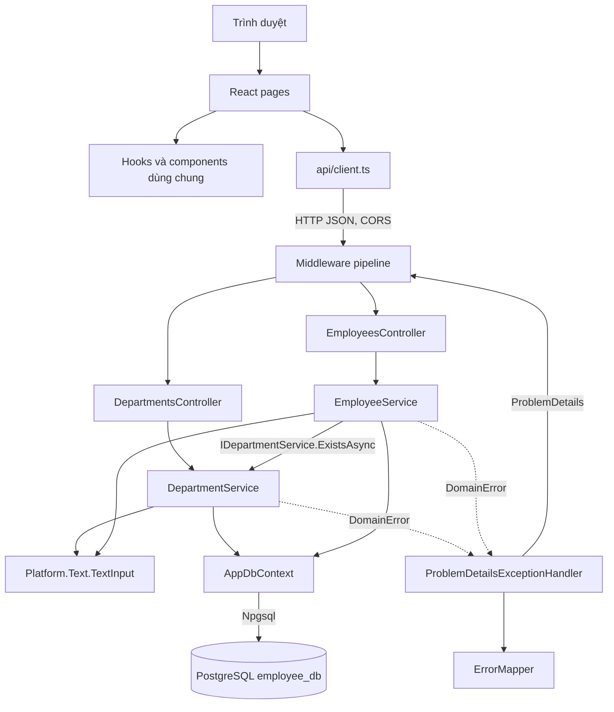
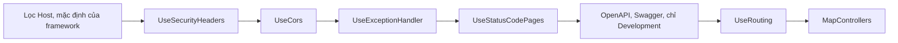
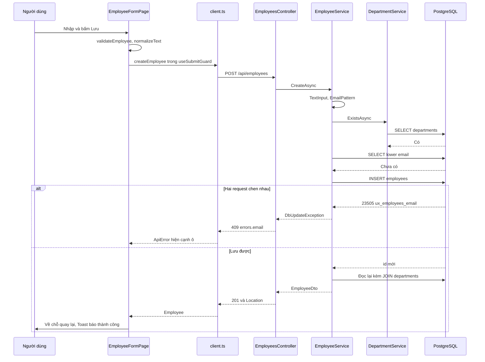
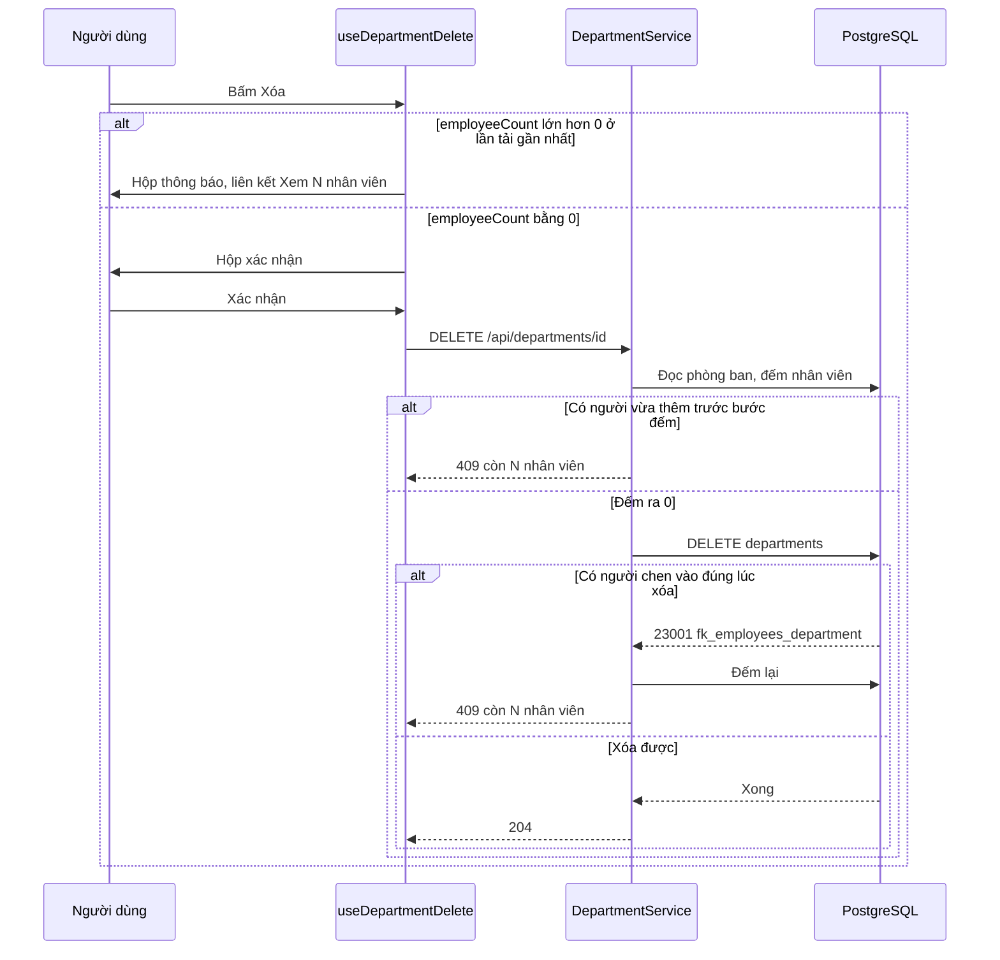
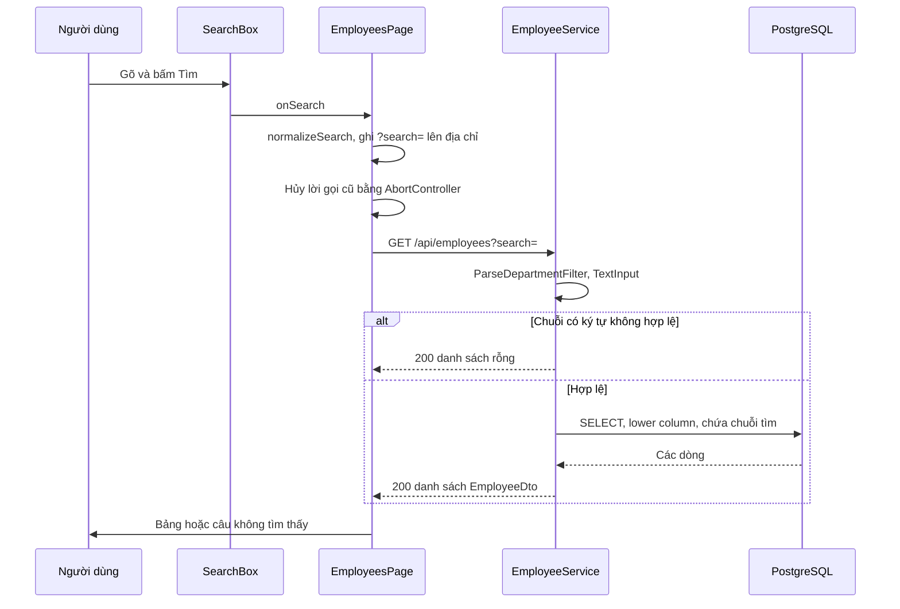
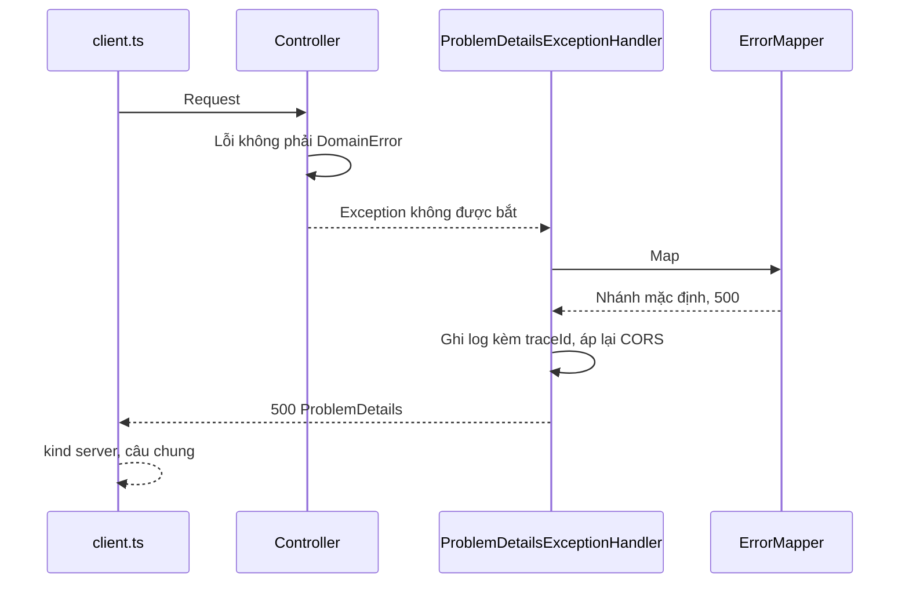
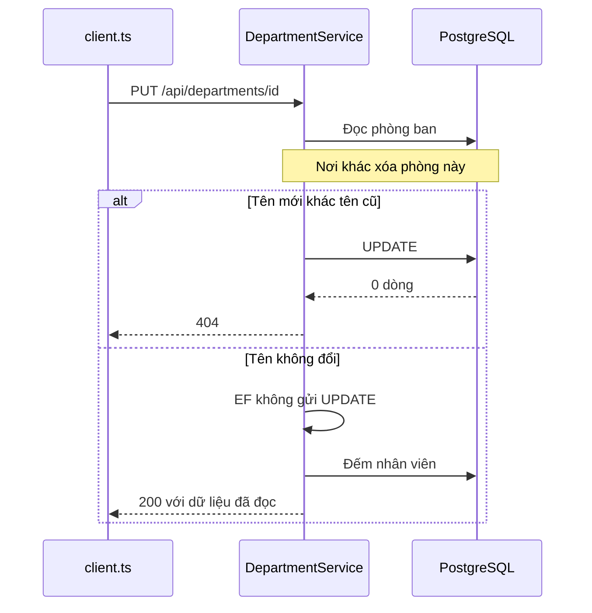

# Kiến trúc

## Architecture Analysis

### System Overview

Một trang React chạy trên trình duyệt gọi một Web API ASP.NET Core qua JSON. API đọc và ghi PostgreSQL trên cùng máy qua EF Core. Hai tiến trình chạy riêng: Vite ở cổng 5173, backend ở cổng 5081, database ở cổng 5432.

### Architectural Style

**Monolith phân tầng, tách frontend.** Bằng chứng: một project API (`EmployeeCrud.Api.csproj`), một DbContext (`AppDbContext`), hai bảng, không hàng đợi, không dịch vụ ngoài. Backend chia thư mục theo tính năng (`Departments/`, `Employees/`) cộng phần nền chung (`Platform/`), trong mỗi tính năng là Controller → Service → EF Core. `project.md` cấm microservices.

### Component Relationships

Bản chữ: trình duyệt chạy các trang React. Trang dùng hook, component chung và `api/client.ts`. Client gọi API qua HTTP JSON. Request đi qua middleware tới `DepartmentsController` hoặc `EmployeesController`. Mỗi controller gọi service của nó; `EmployeeService` hỏi `DepartmentService` qua interface để biết phòng ban có tồn tại. Cả hai service dùng `TextInput` để chuẩn hóa chữ và `AppDbContext` để nói chuyện với PostgreSQL qua Npgsql. Service báo lỗi bằng `DomainError`; `ProblemDetailsExceptionHandler` nhờ `ErrorMapper` đổi lỗi thành ProblemDetails rồi trả ngược ra pipeline.

Thứ tự middleware (`Program.cs:49-67`), thứ tự này có ý nghĩa:

Bản chữ: lọc Host của framework chạy trước, rồi header bảo mật, CORS, bắt lỗi toàn cục, điền nội dung cho phản hồi rỗng, trang OpenAPI ở Development, định tuyến, controller. Header bảo mật gắn bằng `OnStarting` để sống sót khi bộ bắt lỗi xóa header; handler tự áp lại CORS cho cùng lý do.

### Data Flow

- **Ghi:** form kiểm bằng `validateEmployee` hoặc `validateDepartment` → `normalizeText` → JSON → model binding với `[Required]` → service chuẩn hóa lại bằng `TextInput`, kiểm luật → `SaveChangesAsync` → đọc lại thành DTO → JSON → `navigate` về chỗ quay lại kèm lời báo cho `Toast`. Sửa nhân viên đọc lại bằng `GetByIdAsync`; sửa phòng ban tự dựng DTO, không đọc lại (`BE-11`).
- **Đọc:** trang gọi API trong `useEffect` với `AbortController`; danh sách nhân viên lấy `search` và `departmentId` từ địa chỉ trang. Service dùng `AsNoTracking`, chiếu sang DTO trong câu SQL; tên phòng ban lấy bằng JOIN, số nhân viên bằng truy vấn con.
- **Lỗi:** service ném `DomainError` → handler → `ErrorMapper` → ProblemDetails tiếng Việt. Lỗi 23505, 23503, 23001 của PostgreSQL thành 409 hoặc 400. Mọi lỗi lạ thành 500 chung, chi tiết chỉ trong log, tra bằng `traceId`.
- **Hết giờ:** `client.ts` hẹn 10 giây cho mọi lời gọi. Hết giờ thì ra `ApiError` loại `network` với cùng câu "Không kết nối được máy chủ", kể cả POST, PUT, DELETE có thể đã lưu (`FE-15`).

### Key Design Decisions

| Quyết định | Vì sao | Hệ quả |
|---|---|---|
| Thư mục theo tính năng, không theo tầng | Mỗi tính năng gom một chỗ | Controller nằm trong `Departments/`, `Employees/` |
| Không có tầng Repository | Một database, CRUD đơn giản | Service dùng thẳng `AppDbContext` |
| Lỗi nghiệp vụ dùng exception `DomainError` | Service không cần biết HTTP | `ErrorMapper` là hàm thuần, test được từng nhánh |
| Tầng nền `Platform` không phụ thuộc tầng nghiệp vụ | Giữ một chiều phụ thuộc | `ErrorMapper` gõ tay khóa `"name"`, `"email"` (`BE-12`) |
| Kiểm trùng ở service và chốt bằng chỉ mục `lower()` viết tay | Hai request chen nhau vẫn bị chặn | Chỉ mục nằm trong SQL migration, EF snapshot không thấy |
| Hai lớp chuẩn hóa chữ: `TextInput` và `normalizeText` | Form báo sớm, API không tin form | Luật nhân bản, phải đổi cùng nhau |
| Địa chỉ trang là nguồn của `search`, `departmentId` | Back, F5 tự đúng | Không cần kho state; không Redux |
| Trạng thái tải suy ra từ "khóa tải" khi vẽ | Kết quả cũ không đè kết quả mới | Không cần cờ `loading` riêng ở trang danh sách |
| `<dialog>` gốc cho hộp xác nhận | Trình duyệt tự giữ focus | Hook tự trả focus khi đóng |
| User-secrets cho chuỗi kết nối | Không đưa mật khẩu lên Git | Thiếu thì dừng lúc khởi động (`StartupChecks`) |

### Improvement Opportunities

Liệt kê trong `code-quality-assessment.md`. Ở mức kiến trúc chỉ cần lưu ý: khóa trường lỗi nên có một chỗ dùng chung ở backend (`BE-12`); việc kiểm `returnTo` đang nằm riêng trong `EmployeeFormPage`, sẽ cần dùng lại khi sửa `FE-13`.

## Interaction Diagrams

### Giao dịch 1: Thêm nhân viên

Bản chữ: người dùng bấm Lưu; form kiểm và chuẩn hóa rồi gọi API trong `useSubmitGuard` để chặn gửi hai lần. Service chuẩn hóa lại, kiểm định dạng, hỏi `DepartmentService` phòng ban có tồn tại, kiểm email chưa ai dùng, rồi INSERT. Nếu hai request chen nhau, chỉ mục `ux_employees_email` báo 23505 và `ErrorMapper` trả 409 gắn ô email. Nếu lưu được, service đọc lại kèm tên phòng ban và trả 201.

### Giao dịch 2: Xóa phòng ban còn nhân viên

Bản chữ: nếu số người ở lần tải gần nhất lớn hơn 0, giao diện chỉ hiện hộp thông báo và không gọi API. Nếu bằng 0, giao diện hỏi xác nhận rồi gọi DELETE. Service đếm lại; còn người thì trả 409. Nếu có người chen vào đúng lúc xóa, khóa ngoại báo 23001, service đếm lại và vẫn trả 409 cùng một mẫu câu.

### Giao dịch 3: Tìm kiếm và hủy lời gọi cũ

Bản chữ: bấm Tìm thì trang ghi chuỗi đã chuẩn hóa lên địa chỉ; đổi địa chỉ làm effect chạy lại, lời gọi cũ bị hủy. Service kiểm tham số lọc, chuẩn hóa chuỗi tìm; chuỗi có ký tự bị từ chối thì trả rỗng mà không gửi xuống database, còn lại thì truy vấn PostgreSQL.

### Giao dịch 4: Lỗi ngoài dự kiến

Bản chữ: lỗi không phải `DomainError` và không phải lỗi database đã biết thì tới handler, rơi vào nhánh mặc định của `ErrorMapper`, thành 500 câu chung. Trước đây U+FFFE đi đường này; nay `TextInput` chặn sớm và trả 400.

### Giao dịch 5: PUT phòng ban khi phòng vừa bị xóa

Bản chữ: đổi tên thì câu UPDATE không tác động dòng nào và service trả 404. Tên không đổi thì EF không gửi UPDATE nên không có lỗi nào, API trả 200 cho phòng đã mất. Đọc code, chưa chạy. Đây là `BE-11`.
