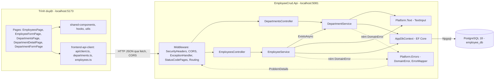
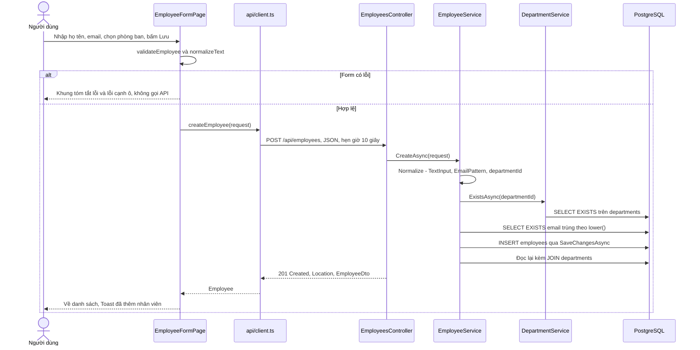
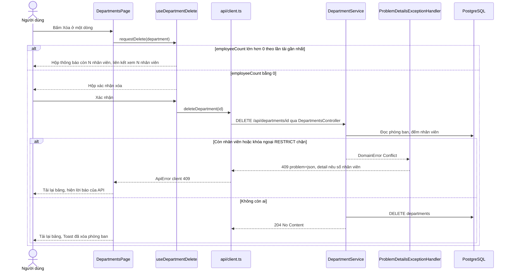
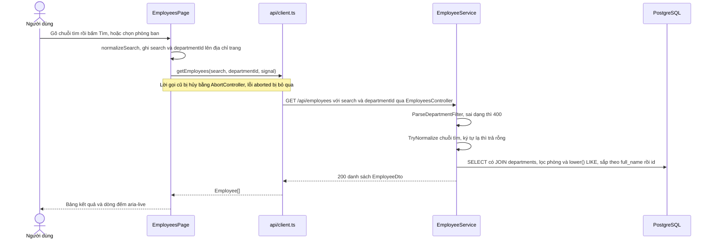
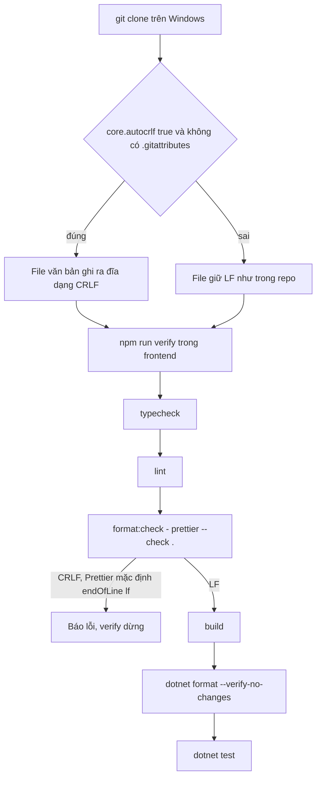

# Architecture: employee-crud

## Architecture Analysis

### System Overview

Ba phần chạy trên cùng một máy:

1. **Frontend** `frontend/`: SPA React + TypeScript dựng bằng Vite, chạy ở `http://localhost:5173`. Định tuyến phía trình duyệt bằng `react-router`; mọi lời gọi API đi qua một chỗ (`src/api/client.ts`).
2. **Backend** `backend/EmployeeCrud.Api/`: ASP.NET Core Web API (.NET 10) kiểu controller, chạy ở `http://localhost:5081`. Mỗi request đi qua chuỗi middleware cố định rồi tới Controller → Service → `AppDbContext` (EF Core).
3. **Database**: PostgreSQL 18 trên máy, database `employee_db`, cấu trúc do hai migration EF Core tạo.

Chi tiết từng thành phần: `component-inventory.md`. Phiên bản: `technology-stack.md`.

### Architectural Style

**Monolith hai tầng tách đôi (SPA + một Web API) trên một database**, không microservice, không message bus, không cache. Bằng chứng: một solution với một project ứng dụng (`backend/EmployeeCrud.slnx`), một gói npm frontend, hai bảng trong một database; `project.md` cấm kiến trúc phức tạp. Trong backend, code chia theo **thư mục tính năng** (`Departments/`, `Employees/`) cộng một thư mục nền dùng chung (`Platform/`), mỗi tính năng theo mẫu Controller → Service (interface + class) → DTO/Request → Entity + `IEntityTypeConfiguration`. Không có tầng Repository riêng: service dùng thẳng `AppDbContext`.

### Component Relationships

Text fallback: Các trang React dùng component, hook, tiện ích dùng chung và gọi API qua `frontend-api-client`. Client gửi HTTP JSON (bị trình duyệt kiểm CORS) tới backend. Request đi qua middleware (header bảo mật, CORS, bộ bắt lỗi, trang mã trạng thái, định tuyến) tới `DepartmentsController` hoặc `EmployeesController`. Controller gọi service tương ứng; `EmployeeService` hỏi `DepartmentService.ExistsAsync` để biết phòng ban có tồn tại. Hai service chuẩn hóa chữ bằng `TextInput`, đọc/ghi qua `AppDbContext`, EF Core dùng Npgsql nói chuyện với PostgreSQL. Lỗi nghiệp vụ được ném dưới dạng `DomainError`, `ErrorMapper` đổi thành ProblemDetails và bộ bắt lỗi ghi phản hồi.

### Data Flow

**Đường đi của một request ghi** (ví dụ thêm nhân viên): form React chuẩn hóa và kiểm dữ liệu → `client.ts` gửi JSON (hẹn giờ 10 giây, hủy được bằng `AbortSignal`) → `SecurityHeaders` đăng ký gắn header lúc phản hồi bắt đầu → CORS → bộ bắt lỗi → `[ApiController]` kiểm model (thiếu trường bắt buộc thì `ValidationResponseFactory` trả 400 tiếng Việt) → controller → service chuẩn hóa, kiểm luật, hỏi database → `SaveChangesAsync` → đọc lại DTO (kèm JOIN tên phòng ban) → 201/200 JSON camelCase. Lỗi đi ngược: `DomainError` hoặc `DbUpdateException` có `PostgresException` → `ErrorMapper.Map` → `application/problem+json` có `traceId`, header CORS được áp lại → `client.ts` đổi thành `ApiError` với `kind` `network`/`server`/`client`/`aborted` → trang hiện lỗi cạnh ô hoặc ở khung tóm tắt.

**Trạng thái phía giao diện**: chuỗi tìm và phòng lọc nằm trên địa chỉ trang (`useSearchParams`), không lưu state riêng; lời báo thành công đi qua `location.state.message` và được `Toast` xóa khỏi lịch sử; không có store toàn cục (không Redux, không Context).

**Mô hình dữ liệu** (nguồn: `Migrations/`, `docs/so-do-database.md`):

| Bảng | Cột | Ràng buộc |
|---|---|---|
| `departments` | `id integer` identity, `name varchar(100) NOT NULL` | `PK_departments`; chỉ mục viết tay `ux_departments_name` UNIQUE trên `lower(name)`; 4 dòng mẫu |
| `employees` | `id integer` identity, `full_name varchar(100)`, `email varchar(254)`, `department_id integer` (đều NOT NULL) | `PK_employees`; `fk_employees_department` → `departments.id` `ON DELETE RESTRICT`; `ix_employees_department_id`; chỉ mục viết tay `ux_employees_email` UNIQUE trên `lower(email)` |

Tên ràng buộc là hợp đồng giữa database và code: `Platform/Errors/DbConstraintNames.cs` giữ ba tên `ux_departments_name`, `ux_employees_email`, `fk_employees_department`; `ErrorMapper` và hai service nhận ra lỗi theo mã SQLSTATE + tên ràng buộc.

### Key Design Decisions

| Quyết định | Lý do (theo comment trong code) | Phương án khác đã thấy hoặc ghi lại | Hệ quả |
|---|---|---|---|
| Luật trùng tên/email kiểm ở service **và** chỉ mục UNIQUE trên `lower()` | Service cho câu báo gắn đúng ô; chỉ mục chặn hai request chen nhau | Chỉ dựa vào service (lọt khi chen nhau); dùng gói đổi tên/collation (không dùng, `team.md` cấm `EFCore.NamingConventions`) | Chỉ mục phải viết tay bằng `migrationBuilder.Sql`, InMemory không kiểm được |
| Lỗi nghiệp vụ là exception `DomainError` 3 loại, một hàm thuần `ErrorMapper` đổi sang HTTP | Service không biết mã HTTP; test được từng nhánh không cần web | Trả `Result<T>` hoặc `IActionResult` từ service | Controller rất mỏng; mọi lỗi ra ProblemDetails tiếng Việt |
| Độ dài đo **sau** chuẩn hóa, không đặt `[MaxLength]` trên Request | Tránh hai câu trả lời khác nhau cho cùng dữ liệu | DataAnnotations đầy đủ | Luật độ dài chỉ có ở service và form |
| `EmployeeService` hỏi phòng ban qua `IDepartmentService.ExistsAsync` | `DepartmentService` giữ quyền trên bảng `departments` | Truy vấn thẳng `db.Departments` | Hai service phụ thuộc một chiều Employee → Department |
| Kiểm dữ liệu chép tay ở frontend (`normalizeText.ts`, `validate*.ts`) cùng câu báo với backend | Báo lỗi ngay, không cần gọi máy chủ; API vẫn kiểm lại | Chỉ kiểm ở API | Phải giữ hai phía khớp bằng tay (xem `code-quality-assessment.md`) |
| Unit test dùng EF Core InMemory | Nhanh, không cần PostgreSQL (`team.md` Q7) | SQLite, Testcontainers (không dùng, cấm Docker) | Chỉ mục `lower()`, RESTRICT, collation tiếng Việt kiểm tay |
| Cấu hình chung chỉ ở máy: connection string qua user-secrets, frontend base URL qua `.env.development` | Không commit bí mật | Để trong `appsettings.json` | Thiếu chuỗi kết nối thì `StartupChecks` dừng ngay với lời hướng dẫn |

**Bảo mật** (không có đăng nhập theo phạm vi): CORS chỉ cho `http://localhost:5173`, chỉ `GET/POST/PUT/DELETE`, chỉ header `Content-Type`, không gửi credentials; `AllowedHosts` giới hạn `localhost;127.0.0.1;[::1]` (chặn DNS rebinding); mọi phản hồi có `X-Content-Type-Options: nosniff`, riêng `/api` thêm `Cache-Control: no-store` và CSP `default-src 'none'; frame-ancestors 'none'`; tắt header `Server`; lỗi 500 không lộ thông điệp gốc; log không ghi body hay chuỗi kết nối; JSON lỗi mã hóa ký tự HTML. Swagger chỉ có ở Development.

### Improvement Opportunities

- **Đầu dòng chưa được repo quy định** (liên quan intent): không có `.gitattributes`, `.editorconfig` không có `end_of_line`, Prettier dùng mặc định `lf`. Hướng thường gặp: khai quy tắc đầu dòng trong `.gitattributes` (và/hoặc `end_of_line` trong `.editorconfig`) rồi chuẩn hóa lại các file. Đây chỉ là ghi nhận; quyết định thuộc các stage sau.
- Không có test tự động so luật kiểm dữ liệu giữa frontend và backend.
- `AppDbContext` (nền) tham chiếu thực thể của hai tính năng: phụ thuộc hai chiều ở mức namespace; chấp nhận được ở quy mô này.
- Không có CI: mọi cổng chất lượng phụ thuộc người chạy `npm run verify` trên máy (đúng phạm vi đề bài).

## Interaction Diagrams

### 1. Thêm nhân viên

Text fallback: Người dùng nhập form và bấm Lưu. Form kiểm và chuẩn hóa trên trình duyệt; có lỗi thì hiện khung tóm tắt và không gọi API. Hợp lệ thì `client.ts` gửi `POST /api/employees`. Controller gọi `EmployeeService.CreateAsync`: chuẩn hóa và kiểm dữ liệu, hỏi `DepartmentService.ExistsAsync`, kiểm email trùng theo `lower()`, lưu, rồi đọc lại DTO kèm tên phòng ban. API trả 201 kèm header `Location`; form quay về danh sách và hiện Toast. Lỗi dữ liệu trả 400, phòng ban không có trả 400 ở ô `departmentId` (form nạp lại danh sách phòng ban), email trùng trả 409 ở ô `email`.

### 2. Xóa phòng ban

Text fallback: Bấm Xóa trên trang danh sách (hoặc trang chi tiết) gọi `useDepartmentDelete`. Nếu số nhân viên của lần tải gần nhất lớn hơn 0, hiện hộp thông báo không có nút xóa, kèm liên kết tới danh sách nhân viên đã lọc theo phòng. Nếu bằng 0, hiện hộp xác nhận; xác nhận thì gọi `DELETE`. Service đọc phòng ban (không có thì 404), đếm lại nhân viên; còn người thì 409. Nếu có người được thêm chen vào sau bước đếm, khóa ngoại RESTRICT chặn (PostgreSQL báo 23001, code bắt cả 23503) và service đếm lại để báo 409 với số đúng (ít nhất 1). Thành công trả 204; trang tải lại bảng và hiện Toast.

### 3. Tìm và lọc nhân viên

Text fallback: Trang Nhân viên lấy chuỗi tìm và phòng lọc từ địa chỉ trang. Mỗi lần đổi, trang hủy lời gọi cũ và gọi `GET /api/employees`. Service kiểm `departmentId` trước (sai dạng thì 400 "Phòng ban lọc không hợp lệ"), chuẩn hóa chuỗi tìm (có ký tự lạ thì trả `[]` không chạm database), rồi chạy một câu SELECT có JOIN, điều kiện phòng và `lower(...) LIKE` trên họ tên hoặc email, sắp theo họ tên rồi id. Phòng trên địa chỉ không còn thì trang bỏ tham số và hiện câu báo.

### 4. Luồng công cụ liên quan intent: `npm run verify` sau khi clone trên Windows

Text fallback: Clone trên Windows với `core.autocrlf=true` (mặc định Git for Windows) và repo không có `.gitattributes` thì file văn bản được ghi ra dạng CRLF. `npm run verify` chạy lần lượt typecheck, lint, `prettier --check .`. Prettier không có cấu hình nên mong đợi LF, thấy CRLF thì báo lỗi; vì các bước nối bằng `&&`, `verify` dừng tại đó và các bước build, `dotnet format`, `dotnet test` không chạy. Với cây LF, chuỗi chạy tiếp đến hết.
