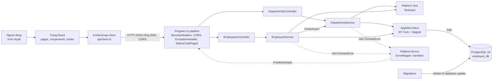
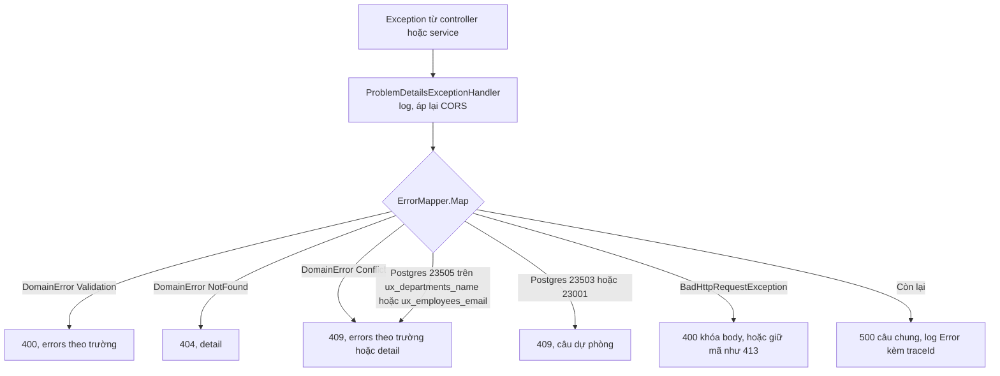
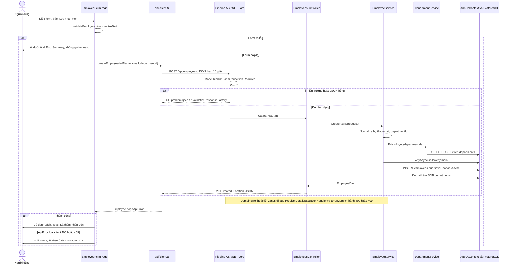
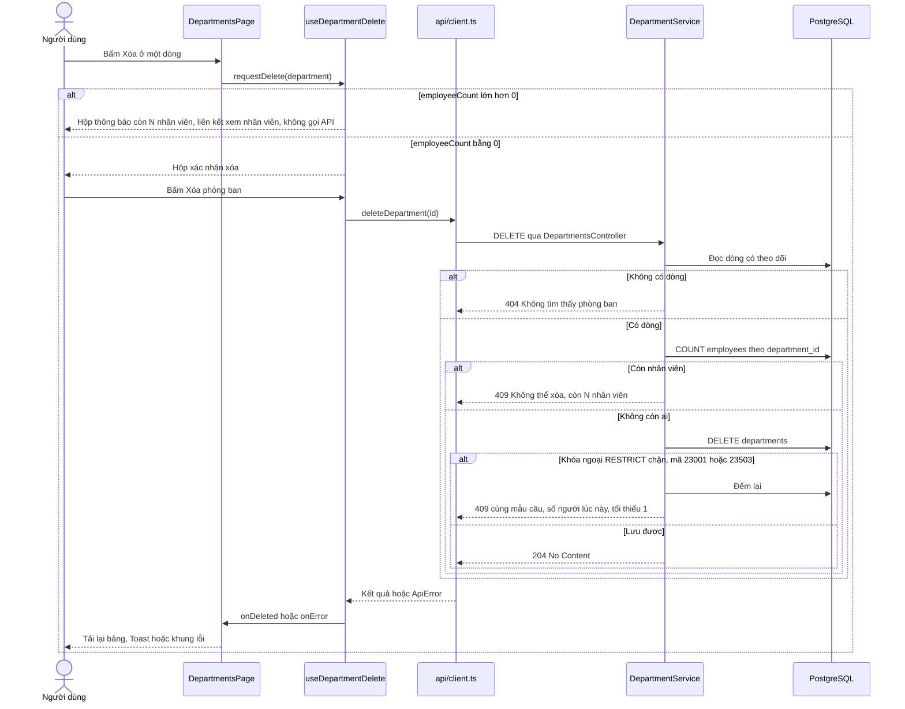
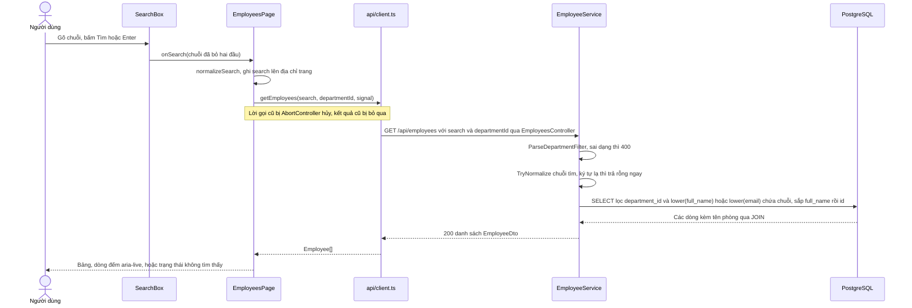

# Architecture: employee-crud

## Architecture Analysis

### System Overview

Một repo gồm hai ứng dụng chạy trên cùng máy, nói chuyện bằng REST JSON:

- **frontend/**: SPA React 19 + TypeScript, dựng bằng Vite, chạy ở `http://localhost:5173` (cổng cố định, `strictPort`).
- **backend/EmployeeCrud.Api**: ASP.NET Core Web API trên .NET 10, chạy ở `http://localhost:5081` (hồ sơ `http`) hoặc `https://localhost:7205`. Controller → Service → DTO, EF Core + Npgsql tới PostgreSQL 18 (`employee_db`, cổng 5432).
- **backend/EmployeeCrud.Api.Tests**: test xUnit cho service (InMemory) và phần nền (WebApplicationFactory).

### Architectural Style

Monolith hai tầng triển khai riêng (một backend, một frontend), không microservices (`project.md` cấm). Backend chia thư mục theo nghiệp vụ: `Departments/`, `Employees/` (mỗi thư mục có entity, cấu hình EF, DTO, request, interface service, service, controller) và `Platform/` cho phần dùng chung (dữ liệu, lỗi, CORS, header bảo mật, chuẩn hóa chữ). Frontend chia `pages/` theo nghiệp vụ, `components/`, `hooks/`, `utils/`, `api/`. Bằng chứng: cây thư mục ở `code-structure.md`.

### Component Relationships

Bằng lời: trang React gọi API qua một client duy nhất; request đi qua chuỗi middleware rồi tới controller; controller chỉ gọi service; `EmployeeService` hỏi `DepartmentService.ExistsAsync` chứ không đọc thẳng bảng phòng ban; cả hai service dùng `TextInput` để chuẩn hóa chữ và `AppDbContext` để đọc/ghi; lỗi nghiệp vụ là `DomainError`, được `Platform.Errors` đổi thành ProblemDetails. Migration chạy tay bằng `dotnet ef`, ứng dụng không tự migrate lúc khởi động.

### Data Flow

1. **Trình duyệt → API**: `client.ts` ghép `VITE_API_BASE_URL` (mặc định `http://localhost:5081`) với đường dẫn, chỉ gửi `Content-Type: application/json` khi có body, đặt hạn 10 giây (gộp `AbortSignal` của trang và của hẹn giờ).
2. **Chuỗi xử lý backend** (`Program.cs:47-68`, thứ tự cố định): lọc `AllowedHosts` (localhost, 127.0.0.1, [::1]) → `UseSecurityHeaders` (gắn header lúc phản hồi bắt đầu gửi) → `UseCors("Frontend")` → `UseExceptionHandler` (`ProblemDetailsExceptionHandler`) → `UseStatusCodePages` (`StatusCodeProblemWriter` cho 404/405/415) → (Development) `MapOpenApi` + Swagger UI → `UseRouting` → `MapControllers`.
3. **Model binding**: `[ApiController]` kiểm `[Required]`; lỗi đi qua `ValidationResponseFactory` (400, khóa camelCase, `application/problem+json`, chữ Việt không bị mã thoát).
4. **Service**: chuẩn hóa → kiểm rẻ (độ dài, định dạng) → kiểm tồn tại phòng ban → kiểm trùng (AnyAsync trên `ToLower()`) → `SaveChangesAsync` → đọc lại DTO (JOIN lấy tên phòng). Đọc dùng `AsNoTracking`; sửa và xóa đọc có theo dõi.
5. **Database**: chỉ mục không trùng trên `lower(name)`, `lower(email)` và khóa ngoại `RESTRICT` chặn ca hai request chen nhau; service và `ErrorMapper` nhận ra lỗi theo mã SQLSTATE + tên ràng buộc (`DbConstraintNames`).
6. **Phản hồi → trình duyệt**: thành công là JSON camelCase (201 kèm `Location`, 204 khi xóa); lỗi là ProblemDetails có `traceId`. `client.ts` đổi mọi lỗi thành `ApiError` (`network`, `server`, `client`, `aborted`), trang hiện lời báo của API nguyên văn.

Đổi lỗi thành mã HTTP:

Bằng lời: mọi exception chưa xử lý tới `ProblemDetailsExceptionHandler`; handler ghi log (Error cho 5xx, Information cho 4xx), áp lại header CORS rồi nhờ `ErrorMapper` (hàm thuần) chọn mã: lỗi kiểm dữ liệu 400, không tìm thấy 404, trùng hoặc vướng ràng buộc 409, request hỏng giữ mã của Kestrel, còn lại 500 với câu chung không lộ chi tiết.

### Key Design Decisions

- **Luật nằm ở service, controller mỏng**: controller chỉ gọi service và trả mã (201 qua `CreatedAtAction`, 204 qua `NoContent`). Service ném `DomainError` không biết mã HTTP; `ErrorMapper` giữ ánh xạ ở một chỗ.
- **Chống trùng hai lớp**: service kiểm trước (câu báo rõ), chỉ mục biểu thức `lower(...)` viết tay trong migration chặn ca chen nhau (EF Core không sinh được chỉ mục biểu thức).
- **Xóa phòng ban**: kiểm số nhân viên trước; khóa ngoại `ON DELETE RESTRICT` (PostgreSQL báo 23001) là lớp dự phòng; cả hai đường ra cùng một mẫu câu.
- **Chuẩn hóa chữ một luật cho hai đầu**: `Platform/Text/TextInput.cs` và `frontend/src/utils/normalizeText.ts`; regex email chép giống hệt ở `EmployeeService.cs` và `validateEmployee.ts`.
- **Tham số lọc `departmentId` nhận dạng chuỗi** để service tự đọc số và báo câu tiếng Việt thay cho câu tiếng Anh của model binding.
- **Độ dài đo sau chuẩn hóa**: request không có `[MaxLength]`; độ dài chỉ kiểm ở service.
- **Bảo mật nền**: không xác thực (ngoài phạm vi); CORS chỉ `http://localhost:5173`, 4 phương thức, header `Content-Type`; `AllowedHosts` chặn Host lạ; `X-Content-Type-Options: nosniff` mọi phản hồi, riêng `/api` thêm `Cache-Control: no-store` và CSP `default-src 'none'; frame-ancestors 'none'`; tắt header `Server`; Swagger chỉ ở Development; chuỗi kết nối nằm trong user-secrets, thiếu thì dừng lúc khởi động (`StartupChecks`).
- **Log gọn**: bốn nhóm log EF Core đặt `Critical` (`appsettings.json`) để mỗi lỗi chỉ một dòng Error do handler ghi, kèm `traceId` trùng body.
- **Frontend**: địa chỉ trang là nguồn đúng cho tìm kiếm/lọc (`useSearchParams`); mỗi effect tải dữ liệu có `AbortController`; route có `key` theo id để form tạo mới khi đổi bản ghi; `useSubmitGuard` chặn bấm đúp bằng `useRef`; lời báo thành công truyền qua `location.state` tới `Toast`.

### Improvement Opportunities

Danh sách đầy đủ, có mã và vị trí, nằm ở `code-quality-assessment.md` mục "Technical debt". Các điểm thuộc kiến trúc: giới hạn kích thước body (CQ-4), đường ghi dự phòng khi `TryWriteAsync` trả `false` (CQ-3), một vùng `Toast` chung ở `AppLayout` thay cho mỗi trang một cái (CQ-9), ghim SDK bằng `global.json` (CQ-7), thống nhất thứ tự kiểm 404/400 giữa hai PUT (CQ-5).

## Interaction Diagrams

### Thêm nhân viên (POST /api/employees)

Bằng lời: form kiểm trước, sai thì không gửi. Hợp lệ thì `client.ts` gửi POST; ASP.NET Core kiểm hình dạng body (thiếu trường thì 400 ngay). Service chuẩn hóa và kiểm theo thứ tự cố định: dữ liệu → phòng ban có không (400) → email trùng (409), rồi INSERT và đọc lại để có tên phòng; controller trả 201 kèm `Location`. Lỗi nghiệp vụ hoặc lỗi trùng do chen nhau được đổi thành ProblemDetails; form hiện lỗi cạnh ô.

### Xóa phòng ban (DELETE /api/departments/{id})

Bằng lời: giao diện dùng `employeeCount` của lần tải gần nhất; phòng còn người thì chỉ mở hộp thông báo. Phòng trống thì gọi DELETE; service đọc dòng (404 nếu mất), đếm nhân viên (409 nếu còn), xóa; nếu có người được thêm chen vào, khóa ngoại chặn và service đếm lại để báo đúng số. Trang tải lại bảng khi thành công, 404 hoặc 409.

### Tìm và lọc nhân viên (GET /api/employees)

Bằng lời: chuỗi tìm và phòng lọc nằm trên địa chỉ trang, nên Back/F5 tự đúng. Mỗi lần đổi, trang hủy lời gọi cũ rồi gọi mới. Service báo 400 nếu `departmentId` sai dạng, trả `[]` ngay nếu chuỗi tìm có ký tự bị chặn (không gửi xuống database), còn lại chạy một câu SQL với `Contains` (EF thoát `%`, `_`), không phân biệt hoa thường nhưng có phân biệt dấu.
