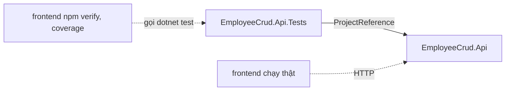

# Phụ thuộc

Phiên bản từng gói ở `technology-stack.md`. File này mô tả ai phụ thuộc ai.

## Phụ thuộc ngoài

| Bên ngoài | Ai dùng | Kiểu | Khi thiếu |
|---|---|---|---|
| PostgreSQL 18 | `AppDbContext` qua Npgsql | Lúc chạy | Backend vẫn khởi động; request cần dữ liệu trả 500 (`StartupChecks.cs:24-25`, `docs/danh-sach-api.md`) |
| Chuỗi kết nối user-secrets | `Program.cs:35-37` | Cấu hình | Dừng lúc khởi động |
| NuGet | `dotnet restore` | Lúc cài | Xem `README.md` mục 4 |
| npm registry | `npm ci` | Lúc cài | Xem `README.md` mục 7 |
| GitHub `Minnhiep/employee-crud` | `README.md:33` | Nguồn code | Repo Private |

Ứng dụng không gọi dịch vụ mạng ngoài lúc chạy. Không tải phông, ảnh hay script từ bên thứ ba.

## Phụ thuộc nội bộ: project



Bản chữ: project test tham chiếu project API. Script `verify` và `coverage` của frontend gọi `dotnet test`. Lúc chạy, frontend chỉ nối với API qua HTTP, không chia sẻ code.

## Phụ thuộc nội bộ: backend

```text
Program                     -> Departments, Employees, Platform.*
Employees.EmployeeService   -> IDepartmentService, Platform.Data, Platform.Errors, Platform.Text
Employees.Employee          -> Departments.Department
Employees.EmployeeConfig    -> Platform.Errors.DbConstraintNames
Departments.DepartmentService -> Platform.Data, Platform.Errors, Platform.Text
Platform.Data.AppDbContext  -> Departments, Employees
Platform.Errors.ProblemDetailsExceptionHandler -> Platform.Cors
Platform.Errors.ErrorMapper -> Platform.Errors (không phụ thuộc nghiệp vụ)
```

Tham chiếu vòng ở mức namespace, không phải lỗi biên dịch vì cùng một assembly:
- `Platform.Data` ↔ `Departments`, `Employees`: `AppDbContext` khai `DbSet`, service dùng `AppDbContext`.
- `Departments` ↔ `Employees`: `EmployeeService` dùng `IDepartmentService`, `DepartmentService` đọc `db.Employees`.

## Phụ thuộc nội bộ: frontend

```text
main.tsx -> App, styles
App -> AppLayout, pages
pages -> api, components, hooks, utils
validateDepartment, validateEmployee -> utils/normalizeText, api/client (kiểu)
DepartmentDetailPage, DepartmentFormPage, EmployeeFormPage, EmployeesPage -> utils/parseId
useDepartmentDelete -> api/departments, ConfirmDialog, useSubmitGuard
ErrorSummary, splitErrors -> api/client (kiểu)
api/departments, api/employees -> api/client
```

Không có import vòng trong số file đã đọc.

## Những chỗ phải đổi cùng nhau

Hai đầu không chia sẻ code, nên các cặp sau được giữ khớp bằng tay:

| Bên backend | Bên frontend | Luật |
|---|---|---|
| `Platform/Text/TextInput.cs` | `utils/normalizeText.ts` | Chuẩn hóa chữ, tập ký tự bị chặn, gồm noncharacter |
| `EmployeeService.EmailPattern` | `validateEmployee.EMAIL_PATTERN` | Định dạng email |
| `*Configuration` hằng độ dài | `validate*` hằng độ dài | 100, 254 ký tự |
| Lời báo trong service | Lời báo trong `validate*` | Cùng câu tiếng Việt |
| `ParseDepartmentFilter`, ràng buộc `{id:int}` | `utils/parseId.ts` `MAX_ID` | Mã là số nguyên dương trong phạm vi `int` |
| `NameField`, `EmailField`, `DepartmentIdField` | `FIELD_NAMES` ở hai trang form | Khóa trong `errors` |
| `appsettings.json` `Cors:AllowedOrigins` | `vite.config.ts` cổng 5173 | Origin được phép |
| `launchSettings.json` cổng 5081 | `.env.development`, `api/client.ts:13` | Địa chỉ backend |
| Tên ràng buộc trong migration | `DbConstraintNames` | Nhận ra lỗi database |

Ngay trong backend cũng có một cặp giữ khớp bằng tay: `ErrorMapper.cs:77`, `:79` với `DepartmentService.NameField`, `EmployeeService.EmailField` (`BE-12`).

Trong frontend: quy tắc kiểm `returnTo` ở `EmployeeFormPage.listPathFrom` sẽ cần dùng ở `DepartmentFormPage` khi sửa `FE-13`.
