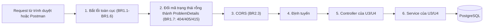
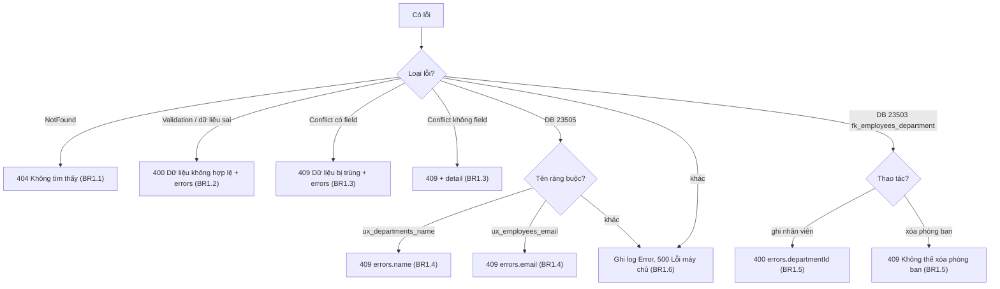
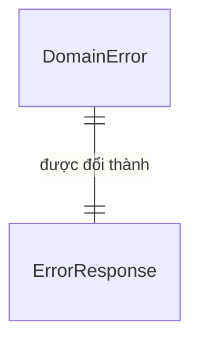

# Đặc tả chức năng: u1-backend-platform

> **Nguồn:**
> - `inception/units-generation/unit-of-work.md` (U1) và `inception/units-generation/unit-of-work-story-map.md`
> - `inception/user-stories/stories.md`: U1 góp phần vào **US4.1, US5.1, US5.2**
> - `inception/requirements-analysis/requirements.md`
> - `inception/domain-design/components.md` (khối Platform, ADR-004)
> - `inception/contract-design/contract-summary.md` (C3, C5)
> - `inception/delivery-planning/bolt-plan.md` (B1)
>
> Hình dạng dữ liệu nằm ở `entities.md`, luật nằm ở `rules.md`. File này là **nguồn chính cho các luồng xử lý** của U1.

## 1. U1 làm gì và không làm gì

- **Làm:**
  - Nền chung cho backend: khởi động có kiểm cấu hình, kết nối PostgreSQL qua một ngữ cảnh database dùng chung.
  - Đổi mọi lỗi thành ProblemDetails tiếng Việt.
  - CORS, OpenAPI, JSON camelCase.
  - Dựng project test, sẵn cho U3 và U4 viết unit test.
- **Không làm:** không có thực thể, migration hay endpoint nghiệp vụ nào (U3, U4 thêm vào).
- **Story:**

  | Story | Phần U1 làm | Phần do unit khác làm |
  |---|---|---|
  | US4.1 | Phía API của lỗi 400/409 (AC4.1.2, phía API của AC4.1.3) | Form (U2, U3, U4) |
  | US5.1 | User-secrets, chuỗi kết nối (AC5.1.2) | README (U5); luồng chạy trọn (U3, U4) |
  | US5.2 | OpenAPI, phong bì lỗi (AC5.2.3, phần khung của AC5.2.4) | Danh sách API (U5); mã thành công (U3, U4) |

## 2. Luồng W1: khởi động ứng dụng

1. Đọc cấu hình theo thứ tự: `appsettings.json` → `appsettings.{Môi trường}.json` → **user-secrets** (chỉ ở Development) → biến môi trường. Nguồn sau ghi đè nguồn trước.
2. Kiểm `ConnectionStrings:Default`.
   - Thiếu hoặc rỗng: ghi lỗi hướng dẫn cách đặt và **dừng**, mã thoát khác 0 (BR2.1).
3. Đăng ký ngữ cảnh database theo vòng đời từng request (BR3.1), bộ xử lý lỗi (BR1.x), chính sách CORS (BR2.3), JSON camelCase (BR2.5), tài liệu OpenAPI (BR2.4).
4. Dựng chuỗi xử lý request theo thứ tự ở W2.
5. Bắt đầu nhận request. Chưa thử kết nối database lúc khởi động: kết nối được kiểm bằng lệnh `dotnet ef dbcontext info` ở luồng W4.

## 3. Luồng W2: chuỗi xử lý một request (thứ tự quan trọng)



<!-- Text fallback: Request đi qua theo thứ tự: bắt lỗi toàn cục, đổi mã trạng thái rỗng thành ProblemDetails, CORS, định tuyến, controller, service, rồi tới PostgreSQL. -->

- Bước 1 đứng **đầu tiên**, để bất kỳ lỗi nào phía sau cũng được đổi thành ProblemDetails.
- Khi bước 1 xử lý một lỗi, phản hồi lỗi vẫn đi lại qua bước 3, nên vẫn mang header CORS (BR2.3). Nhờ vậy trình duyệt đọc được lời báo thay vì thấy "lỗi mạng" (điểm R-07 của Contract Design).
- Bước 2 lo các phản hồi lỗi không có nội dung mà framework tự sinh: đường dẫn lạ, sai phương thức, sai kiểu nội dung (BR1.7).

## 4. Luồng W3: đổi lỗi thành phản hồi



<!-- Text fallback: Lỗi NotFound thành 404; dữ liệu sai thành 400 có errors; Conflict có field thành 409 có errors, không field thành 409 có detail; lỗi database 23505 nhận ra theo tên ràng buộc thành 409 cho tên phòng ban hoặc email, tên khác thành 500; lỗi 23503 khi ghi nhân viên thành 400 departmentId, khi xóa phòng ban thành 409; mọi lỗi khác ghi log và trả 500. -->

Mọi nhánh đều trả `application/problem+json` (BR1.8). Ví dụ một phản hồi:

```json
{
  "type": "https://tools.ietf.org/html/rfc9110#section-15.5.10",
  "title": "Dữ liệu bị trùng",
  "status": 409,
  "errors": { "email": ["Email đã được sử dụng"] }
}
```

## 5. Luồng W4: Hiệp tự kết nối database (AI chỉ hướng dẫn)

Theo lời Hiệp ở Delivery Planning Q4: "kết nối DB hay j thì chỉ tôi nhé, otio kết nối luôn vì tôi có tải rồi". Code Generation **viết các bước này thành hướng dẫn**; Hiệp tự làm, AI không gõ mật khẩu hộ.

1. Mở pgAdmin, tạo database `employee_db` (owner là tài khoản PostgreSQL Hiệp dùng).
2. Trong thư mục project API, chạy `dotnet user-secrets set "ConnectionStrings:Default" "Host=localhost;Port=5432;Database=employee_db;Username=<tài khoản>;Password=<mật khẩu>"`. Project đã được bật user-secrets từ lúc tạo.
3. Chạy `dotnet tool restore` để có `dotnet ef` cài cục bộ, rồi `dotnet ef dbcontext info`. **Đạt** khi lệnh in ra provider Npgsql và tên database `employee_db`, không báo lỗi kết nối.
4. Nếu lỗi: Hiệp dán thông báo lỗi để AI chỉ cách sửa. Các lỗi hay gặp là sai mật khẩu, dịch vụ PostgreSQL chưa chạy, hoặc chưa tạo database.

## 6. Trạng thái

U1 không có thực thể nào có vòng đời, nên **không có máy trạng thái**.

## 7. Sơ đồ quan hệ thực thể (lấy từ `entities.md`)

U1 không có bảng nào. Hai bảng `departments` và `employees` do U3, U4 tạo bằng migration, nhưng phải dùng **đúng tên ràng buộc** trong `entities.md` (`ux_departments_name`, `ux_employees_email`, `fk_employees_department`) để BR1.4 và BR1.5 nhận ra lỗi.



<!-- Text fallback: Mỗi DomainError được đổi thành đúng một ErrorResponse. -->

## 8. Tóm tắt luật (lấy từ `rules.md`)

| Nhóm | Luật | Ý chính |
|---|---|---|
| Đổi lỗi | BR1.1–BR1.8 | 404 / 400 / 409 / 500, cùng các lỗi do framework và database sinh, đều theo phong bì C3 |
| Cấu hình và bảo mật | BR2.1–BR2.5 | User-secrets, không commit mật khẩu, CORS, OpenAPI chỉ ở Development, JSON camelCase |
| Xử lý request | BR3.1–BR3.2 | Truy cập database bất đồng bộ theo từng request; log không chứa bí mật |

## 9. Kiểm như thế nào

| Kiểm | Cách làm | Luật |
|---|---|---|
| Build và test | `dotnet build`, `dotnet test` chạy được (project test chưa có test nghiệp vụ; mỗi luật đổi lỗi có unit test cho bộ đổi lỗi) | BR1.1–BR1.6 |
| Đường dẫn lạ | Postman: `GET /api/khong-ton-tai` trả 404, `application/problem+json`, title tiếng Việt | BR1.7, BR1.8 |
| Thiếu chuỗi kết nối | Xóa user-secrets rồi `dotnet run`: ứng dụng dừng, in hướng dẫn | BR2.1 |
| CORS | Từ `http://localhost:5173`, gọi một đường dẫn lạ: trình duyệt đọc được phản hồi 404 (không báo lỗi CORS) | BR2.3 |
| OpenAPI | Development mở được; Production không có | BR2.4 |
| Kết nối DB | `dotnet ef dbcontext info` đạt (Hiệp tự làm, W4) | BR2.1 |
