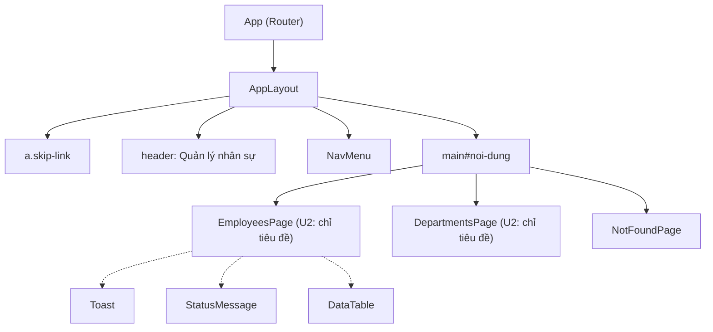

# Component giao diện: u2-web-shell

> **Nguồn:** `inception/refined-mockups/interaction-spec.md` (mục 2–3), `design-system-mapping.md` (mục 1, 4), `mockups.md` (mục 1–2), `rules.md` (U2), `contract-summary.md` C3.
>
> Mô tả ở mức thiết kế: tên, nhiệm vụ, props, trạng thái và luật. Code cụ thể thuộc Code Generation.
>
> **Cập nhật 2026-11-01:** Hiệp đổi frontend sang TypeScript. Mọi tên file `.jsx` dưới đây là `.tsx`, file `.js` trong `src/` là `.ts` (ví dụ `api/client.ts`); props của mỗi component được khai báo bằng kiểu TypeScript.

## 1. Cây component

<!-- Text fallback: App chứa Router; AppLayout gồm liên kết bỏ qua, header, NavMenu và vùng main; trong main là trang Nhân viên, trang Phòng ban hoặc trang 404. Các trang danh sách (U3, U4) sẽ dùng Toast, StatusMessage và DataTable. -->

Các form của U3, U4 sẽ dùng `ErrorSummary` và `FormField`.

## 2. Thư mục dự kiến trong `frontend/src/`

| Thư mục / file | Nội dung |
|---|---|
| `main.jsx` | Gắn ứng dụng vào trang, nạp ba file CSS |
| `App.jsx` | Bảng đường dẫn (BR1.1) |
| `api/client.js` | Gọi API (BR2.1–BR2.5) |
| `components/` | `AppLayout`, `NavMenu`, `StatusMessage`, `Toast`, `DataTable`, `ErrorSummary`, `FormField` |
| `hooks/usePageTitle.js` | Đặt `document.title` và focus `h1` khi đổi trang (BR1.2) |
| `pages/` | `EmployeesPage`, `DepartmentsPage` (U2 chỉ có tiêu đề), `NotFoundPage` |
| `styles/` | `tokens.css`, `base.css`, `components.css` |

U3, U4 thêm `pages/departments/...`, `pages/employees/...` và các hàm gọi API riêng (`api/departments.js`, `api/employees.js`) dựa trên `client.js`.

## 3. Component

### 3.1 `AppLayout`

| Mục | Nội dung |
|---|---|
| Nhiệm vụ | Khung chung cho mọi trang |
| Props | không (nhận trang con qua Router) |
| Cấu trúc | `a.skip-link[href="#noi-dung"]` "Bỏ qua, tới nội dung chính" → `header.layout__header` (tên ứng dụng + `NavMenu`) → `main#noi-dung[tabindex="-1"]` |
| Luật | BR1.3, BR1.5, BR4.2 |

### 3.2 `NavMenu`

| Mục | Nội dung |
|---|---|
| Nhiệm vụ | Hai liên kết "Nhân viên" (`/employees`), "Phòng ban" (`/departments`) |
| Cấu trúc | `nav[aria-label="Chính"] > ul > li > NavLink.nav__link` |
| Trạng thái | default, hover (gạch dưới), focus (viền 3px), active (`aria-current="page"`, đậm + gạch dưới, `nav__link--active`) |
| Luật | BR1.4 |

### 3.3 `usePageTitle(title)` (hook)

| Mục | Nội dung |
|---|---|
| Nhiệm vụ | Mỗi trang gọi một lần với tên trang; trả về ref gắn vào `h1` |
| Hành vi | Đặt `document.title = "<title> – Quản lý nhân sự"`; nếu không phải lần mở đầu tiên của ứng dụng thì focus `h1` (`tabindex="-1"`) |
| Luật | BR1.2 |

### 3.4 `StatusMessage`

| Prop | Kiểu | Bắt buộc | Mô tả |
|---|---|---|---|
| kind | `"loading" \| "error" \| "empty"` | có | Loại trạng thái |
| message | chuỗi | có | Lời báo tiếng Việt |
| action | `{ label, onClick }` hoặc `{ label, to }` | không | Nút "Thử lại" hoặc liên kết "+ Thêm ..." |

| kind | Vai trò | Hình thức (class) |
|---|---|---|
| loading | `role="status"` | `status status--loading`, biểu tượng xoay `aria-hidden` |
| error | `role="alert"` | `status status--error`, (!) + chữ |
| empty | — | `status status--empty` |

Luật: BR3.1.

### 3.5 `Toast`

| Mục | Nội dung |
|---|---|
| Nhiệm vụ | Hiện lời báo thành công nhận qua trạng thái điều hướng (`location.state.message`) |
| Props | không |
| Trạng thái | ẩn (không có lời báo) → hiện → ẩn sau 5 giây |
| Cấu trúc | `div.alert.alert--success[role="status"]`: "✓" (`aria-hidden`) + lời báo |
| Hành vi | Sau khi đọc lời báo, thay địa chỉ hiện tại với trạng thái rỗng (để F5 không hiện lại); hủy hẹn giờ khi rời trang |
| Luật | BR3.2 |

### 3.6 `DataTable`

| Prop | Kiểu | Bắt buộc | Mô tả |
|---|---|---|---|
| caption | chuỗi | có | Tên bảng cho trình đọc màn hình |
| columns | `{ key, header, render? }[]` | có | Cột; `render` để định dạng ô |
| rows | object[] (có `id`) | có | Dữ liệu |
| renderActions | hàm `(row) => nút` | không | Cột "Thao tác" (nút Sửa/Xóa do U3, U4 truyền vào, có `aria-label` đủ tên mục) |

Cấu trúc: `div.table-wrap[role="region"][aria-label=caption][tabindex="0"] > table.table > caption, thead > tr > th[scope="col"], tbody`. `rows` rỗng thì không vẽ gì. Luật: BR4.1.

### 3.7 `ErrorSummary`

| Prop | Kiểu | Bắt buộc | Mô tả |
|---|---|---|---|
| fieldErrors | `{ [tênÔ]: string[] }` | không | Lỗi gắn ô; mỗi lời báo thành liên kết `#<id ô>` |
| fieldLabels | `{ [tênÔ]: nhãn }` | không | Để ghi "Họ tên: Vui lòng nhập họ tên" |
| messages | string[] | không | Lỗi không gắn ô (khóa lạ, detail, lỗi mạng) |

Cấu trúc: `div.alert.alert--error[role="alert"][tabindex="-1"]`, tiêu đề "Vui lòng sửa các lỗi sau:", `ul > li`. Có lỗi mới vẽ; form gọi `focus()` vào khung khi bấm Lưu mà có lỗi. Kèm hàm tiện ích `splitErrors(errors, fieldNames)` → `{ fieldErrors, otherMessages }` (BR3.3).

### 3.8 `FormField`

| Prop | Kiểu | Bắt buộc | Mô tả |
|---|---|---|---|
| id | chuỗi | có | `id` của ô; dòng lỗi có id `<id>-loi`, gợi ý `<id>-goi-y` |
| label | chuỗi | có | Nhãn hiện trên ô |
| required | boolean | không | Thêm dấu * (`aria-hidden`) và `aria-required` |
| hint | chuỗi | không | Gợi ý dưới nhãn |
| errors | string[] | không | Lời báo lỗi của ô |
| children | phần tử ô nhập | có | `input` hoặc `select`; FormField gắn `aria-invalid`, `aria-describedby` |

Cấu trúc: `div.field(.field--invalid) > label[for] + p.field__hint + ô + p.field__error` ((!) + chữ). Luật: BR3.3, BR4.2.

### 3.9 Trang

| Trang | Đường dẫn | Ở U2 |
|---|---|---|
| `EmployeesPage` | `/employees` | `h1` "Nhân viên" (U4 thay nội dung) |
| `DepartmentsPage` | `/departments` | `h1` "Phòng ban" (U3 thay nội dung) |
| `NotFoundPage` | `*` | `h1` "Không tìm thấy trang", câu giải thích, liên kết "Về trang Nhân viên" |
| (chuyển hướng) | `/` | `Navigate` tới `/employees`, kiểu thay thế |

## 4. `src/api/client.js`

| Hàm | Mô tả |
|---|---|
| `apiGet(path)` | GET, trả JSON |
| `apiPost(path, body)` | POST JSON, trả JSON (201) |
| `apiPut(path, body)` | PUT JSON, trả JSON (200) |
| `apiDelete(path)` | DELETE, trả rỗng (204) |

Lỗi ném ra là `ApiError` gồm: `kind` (`network` \| `server` \| `client`), `status` (số, hoặc 0 khi lỗi mạng), `title`, `detail`, `errors` (object, mặc định rỗng), `message` (lời báo nên hiện). Luật: BR2.1–BR2.5.

Cấu hình: `frontend/.env.development` có `VITE_API_BASE_URL=http://localhost:5081` (Q1 = A); thiếu biến thì dùng chính giá trị này.

## 5. Luật kiểm dữ liệu form

U2 không có form nghiệp vụ. Luật kiểm từng ô (họ tên, email, phòng ban, tên phòng ban) do U3, U4 viết theo `interaction-spec.md` mục 2.5; U2 chỉ cung cấp `FormField`, `ErrorSummary`, `splitErrors` và kiểu CSS.

## 6. Điểm tích hợp

| Với | Qua | Ghi chú |
|---|---|---|
| U1 (backend) | HTTP JSON tới `http://localhost:5081`, CORS cho `http://localhost:5173` | Phong bì lỗi C3 |
| U3, U4 | Import component, `client.js`, CSS | Thêm trang và đường dẫn vào `App.jsx` |
