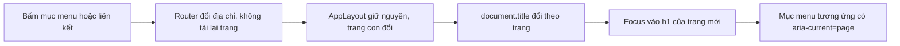
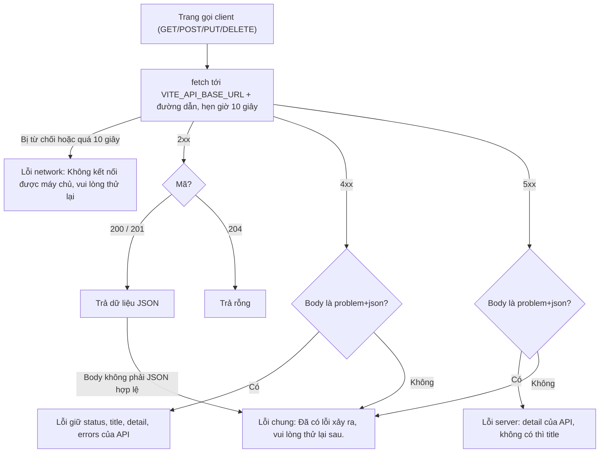
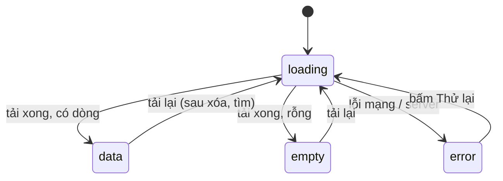

# Đặc tả chức năng: u2-web-shell

> **Nguồn:**
> - `inception/units-generation/unit-of-work.md` (U2), `unit-of-work-story-map.md`
> - `inception/user-stories/stories.md`: U2 góp phần dùng chung cho **US4.1–US4.6**
> - `inception/refined-mockups/` (`mockups.md`, `interaction-spec.md`, `design-system-mapping.md`, `accessibility-checklist.md` G1–G6)
> - `inception/domain-design/components.md` (khối WebUi, ADR-005), `inception/contract-design/contract-summary.md` (C3)
> - `functional-design-questions.md` Q1 = A
>
> Luật nằm ở `rules.md`; component, props và trạng thái nằm ở `frontend-components.md`. File này là **nguồn chính cho các luồng và chuyển trạng thái màn hình** của U2. U2 không có thực thể nên không có `entities.md` và không có sơ đồ quan hệ thực thể.

## 1. U2 làm gì và không làm gì

- **Làm:**
  - Dự án Vite + React (**TypeScript**, Hiệp đổi từ JavaScript ngày 2026-11-01) trong `frontend/`, chạy ở `http://localhost:5173`. Tên file trong tài liệu này viết `.jsx`/`.js` được hiểu là `.tsx`/`.ts` (ví dụ `client.ts`).
  - Khung trang chung: liên kết bỏ qua, header "Quản lý nhân sự", menu, vùng nội dung, vùng thông báo.
  - Router: `/` → `/employees`, hai trang chỉ có tiêu đề, trang 404.
  - Component dùng chung: `StatusMessage`, `Toast`, `DataTable`, `ErrorSummary`, `FormField`.
  - Module gọi API `src/api/client.ts` (đọc ProblemDetails, hạn 10 giây, nhận biết lỗi mạng).
  - CSS chung: `tokens.css`, `base.css`, `components.css`.
  - ESLint (cấu hình Vite tạo), Prettier, `lang="vi"`.
- **Không làm:** chưa có màn hình nghiệp vụ, chưa gọi API thật nào (U3, U4). Không Redux, không thư viện CSS.
- **Story (phần U2):**

  | Story | Phần U2 làm | Phần do unit khác làm |
  |---|---|---|
  | US4.1 | Cách hiện lỗi dùng chung: `ErrorSummary`, `FormField`, `client.ts` giữ lời báo API | Luật kiểm từng form (U3, U4); ProblemDetails (U1) |
  | US4.2 | `StatusMessage` (tải / lỗi / rỗng), lỗi mạng trong `client.ts` | Dùng ở từng trang (U3, U4) |
  | US4.3 | Menu, router, chữ tiếng Việt của khung trang | Đường dẫn form và chữ trang nghiệp vụ (U3, U4) |
  | US4.4 | Kiểu nút khóa `btn[disabled]`, cách khóa nút | Khóa nút ở từng form và nút xóa (U3, U4) |
  | US4.5 | `Toast` | Lời báo "Đã ..." và nút Hủy của từng form (U3, U4) |
  | US4.6 | CSS cho nhãn, dấu *, dòng lỗi; `FormField` | Nhãn từng ô (U3, U4) |

## 2. Luồng W1: mở ứng dụng

1. Trình duyệt tải `index.html` (`<html lang="vi">`, `<title>Quản lý nhân sự</title>`) và bản JavaScript do Vite build.
2. Ứng dụng nạp CSS theo thứ tự `tokens.css` → `base.css` → `components.css`.
3. Router đọc địa chỉ:
   - `/` → thay bằng `/employees` (BR1.1);
   - `/employees`, `/departments` → trang tương ứng;
   - địa chỉ khác → trang 404.
4. `AppLayout` vẽ khung, trang con vẽ vào `<main id="noi-dung">`. `document.title` đặt theo trang (BR1.2). Focus giữ ở đầu trang, để Tab đầu tiên tới liên kết bỏ qua (BR1.3).
5. U2 **không** gọi API lúc mở ứng dụng; trang của U3, U4 tự gọi khi cần.

## 3. Luồng W2: chuyển trang

<!-- Text fallback: Bấm menu hoặc liên kết thì router đổi địa chỉ mà không tải lại trang; khung trang giữ nguyên, trang con đổi; tiêu đề trình duyệt đổi; focus vào h1 của trang mới; mục menu tương ứng được đánh dấu đang mở. -->

- Nút quay lại / tiến tới của trình duyệt đi đúng luồng này.
- Menu "Nhân viên" vẫn được đánh dấu khi ở trang con `/employees/...` (form của U4); tương tự "Phòng ban" (BR1.4).

## 4. Luồng W3: một lời gọi API qua `client.ts`

<!-- Text fallback: Trang gọi client; client gọi fetch với hạn 10 giây. Bị từ chối hoặc quá hạn thì báo lỗi mạng. 200/201 trả JSON, 204 trả rỗng. 4xx có ProblemDetails thì giữ nguyên title, detail, errors; không có thì báo lỗi chung. 5xx có ProblemDetails thì dùng detail của API (không có thì title); không có ProblemDetails thì báo lỗi chung. 200/201 mà body không phải JSON hợp lệ cũng báo lỗi chung. Máy chủ vẫn trả lời được nên hai trường hợp này không báo lỗi mạng (đổi có chủ đích ở Code Generation Step 10, review R-10). -->

- Không có lần gọi lại tự động nào (BR2.2). Trang hiện lỗi và nút "Thử lại"; người dùng bấm mới gọi lại.
- Trang phân biệt các loại lỗi bằng `kind` (`network`, `server`, `client`) và `status` mà client trả về, không đọc chuỗi lời báo.

## 5. Luồng W4: hiện lỗi trên form (cơ chế dùng chung cho U3, U4)

1. Người dùng bấm Lưu. Form kiểm trên trình duyệt (luật của từng form do U3, U4 viết).
2. Có lỗi → form gom lỗi thành `{ tênÔ: [lời báo] }`.
3. Có lời gọi API lỗi 400/409 → lấy `errors` của lỗi; lỗi khác (mạng, 404, 409 không gắn ô) → một lời báo chung.
4. Chia lỗi (BR3.3): khóa trùng tên ô → `FormField` của ô đó; còn lại → `ErrorSummary`.
5. `ErrorSummary` hiện ở đầu form (`role="alert"`) và nhận focus; mỗi lỗi gắn ô là liên kết tới ô.
6. Dữ liệu trên form giữ nguyên; nút Lưu mở lại (BR3.4).

## 6. Luồng W5: thông báo thành công

1. Form của U3/U4 lưu thành công → chuyển về trang danh sách, kèm lời báo trong trạng thái điều hướng (ví dụ "Đã thêm nhân viên").
2. Trang danh sách đặt `Toast` ở đầu `<main>`; `Toast` đọc lời báo, hiện "✓ ..." trong `role="status"`.
3. Sau khi hiện, xóa lời báo khỏi trạng thái điều hướng (thay địa chỉ hiện tại), để F5 không hiện lại.
4. Sau 5 giây tự ẩn. Rời trang trước 5 giây thì hủy hẹn giờ (BR3.2).

## 7. Trạng thái màn hình

### 7.1 Trang danh sách (khung mà U3, U4 dùng)

<!-- Text fallback: Trang danh sách bắt đầu ở trạng thái đang tải; tải xong có dòng thì sang có dữ liệu, rỗng thì sang trống, lỗi thì sang lỗi; từ lỗi bấm Thử lại thì về đang tải; từ có dữ liệu hoặc trống, tải lại thì về đang tải. -->

| Trạng thái | Hiện gì | Luật |
|---|---|---|
| loading | `StatusMessage kind="loading"`: "Đang tải..." | BR3.1 |
| data | `DataTable` | BR4.1 |
| empty | `StatusMessage kind="empty"` + nút hành động | BR3.1 |
| error | `StatusMessage kind="error"` + nút "Thử lại" | BR3.1, BR2.3 |

### 7.2 Nút gửi form

| Trạng thái | Hiện gì | Chuyển khi |
|---|---|---|
| idle | Nút "Lưu" bấm được | — |
| submitting | Nút "Đang lưu..." bị khóa | Bấm Lưu, dữ liệu hợp lệ |
| idle (có lỗi) | Nút mở lại, lỗi hiện theo W4 | API trả lỗi |
| (rời trang) | Về danh sách, `Toast` | API trả thành công |

### 7.3 Trang 404

Tiêu đề `h1` "Không tìm thấy trang", câu "Địa chỉ bạn mở không có trong ứng dụng." và liên kết "Về trang Nhân viên". `document.title` = "Không tìm thấy trang – Quản lý nhân sự".

## 8. Tóm tắt luật (lấy từ `rules.md`)

| Nhóm | Luật | Ý chính |
|---|---|---|
| Điều hướng, khung trang | BR1.1–BR1.5 | Đường dẫn, tiêu đề + focus khi đổi trang, liên kết bỏ qua, menu đang mở, tiếng Việt |
| Gọi API | BR2.1–BR2.5 | Một module, địa chỉ `http://localhost:5081`, hạn 10 giây, không gọi lại, giữ lời báo API |
| Trạng thái, lỗi, thông báo | BR3.1–BR3.4 | `StatusMessage`, `Toast`, lỗi theo ô + tóm tắt, khóa nút |
| Chuẩn giao diện | BR4.1–BR4.2 | Bảng chuẩn, biến CSS chung, focus thấy rõ |

## 9. Chuẩn chất lượng áp dụng (G1–G6, Hiệp đặt ở Refined Mockups)

U2 dựng nền để đạt các mục tiêu này; Build and Test đo trên bản build:
- G1 WCAG 2.1 AA; G2 Lighthouse Accessibility 100; G3 Performance ≥ 90; G4 chuyển trang không tải lại; G5 Best Practices ≥ 90 và console sạch; G6 HTML hợp lệ (W3C).
- Ở U2 kiểm được ngay: khung trang, trang 404, hai trang rỗng.

## 10. Kiểm như thế nào

| Kiểm | Cách làm | Luật |
|---|---|---|
| Chạy được | `npm install`, `npm run dev`, mở `http://localhost:5173`: tự chuyển tới `/employees` | BR1.1 |
| Lint, định dạng | `npm run lint` sạch; `npx prettier --check .` sạch | — |
| Liên kết bỏ qua | Nhấn Tab lần đầu: thấy liên kết; Enter: focus vào nội dung chính | BR1.3 |
| Đổi trang | Bấm "Phòng ban": địa chỉ đổi, tab Network không tải lại HTML, tiêu đề tab đổi, mục menu đậm + gạch dưới | BR1.2, BR1.4, G4 |
| Trang 404 | Mở `/abc`: thấy "Không tìm thấy trang" và liên kết về Nhân viên | BR1.1 |
| `client.ts` | Unit test cho client không bắt buộc (team.md chỉ test service backend); kiểm bằng tay ở U3 khi có API thật: tắt backend → "Không kết nối được máy chủ, vui lòng thử lại" | BR2.x |
| Component dùng chung | Kiểm bằng tay khi U3 dùng tới | BR3.x, BR4.x |
