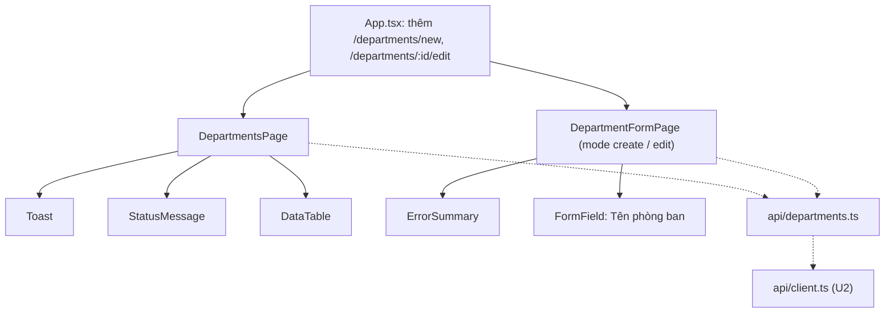

# Component giao diện: u3-departments

> **Nguồn:** `inception/refined-mockups/` (`mockups.md` mục 5–8, `interaction-spec.md` mục 2.3, 2.5, 2.6, 2.7, 3, luồng F2, F3), `rules.md` (BR4.x), phần dùng chung của U2 (`client.ts`, `StatusMessage`, `Toast`, `DataTable`, `FormField`, `ErrorSummary`, `splitErrors`, `useSubmitGuard`, `usePageTitle`).
>
> TypeScript `strict`. Mọi chữ hiển thị tiếng Việt.

## 1. Cây component

<!-- Text fallback: App thêm hai đường dẫn form. Trang danh sách dùng Toast, StatusMessage và DataTable; trang form dùng ErrorSummary và FormField. Cả hai gọi api/departments.ts, file này dựa trên client.ts của U2. -->

## 2. File dự kiến

| File | Nội dung |
|---|---|
| `src/api/departments.ts` | `type Department = { id: number; name: string }`; `type DepartmentRequest = { name: string }`; `getDepartments(signal?)`, `getDepartment(id, signal?)`, `createDepartment(req)`, `updateDepartment(id, req)`, `deleteDepartment(id)` |
| `src/pages/departments/DepartmentsPage.tsx` | Thay trang chỉ có tiêu đề của U2 |
| `src/pages/departments/DepartmentFormPage.tsx` | Form thêm và sửa |
| `src/pages/departments/validateDepartment.ts` | Hàm thuần kiểm tên: trả `FieldErrors` (BR1.1–BR1.3) |
| `src/App.tsx` | Thêm hai đường dẫn form |

## 3. `DepartmentsPage`

| Trạng thái (state) | Kiểu | Ý nghĩa |
|---|---|---|
| `status` | `"loading" \| "error" \| "ready"` | Trạng thái tải |
| `departments` | `Department[]` | Dữ liệu |
| `loadError` | `string` | Lời báo khi tải lỗi |
| `actionError` | `string` | Lời báo lỗi khi xóa (409, lỗi mạng), hiện `role="alert"` ở đầu trang |

- **Tải:** hàm `loadDepartments()` dùng `AbortController` (hủy khi rời trang, bỏ qua `ApiError` loại `aborted`). Gọi khi mở trang, khi bấm "Thử lại" và **ngay sau khi xóa xong** (rà soát U2).
- **Đầu trang:** `h1` "Phòng ban" (`usePageTitle`), liên kết `btn btn--primary` "+ Thêm phòng ban" tới `/departments/new`, `Toast`, khung `actionError`.
- **Bảng:** `DataTable` caption "Danh sách phòng ban", cột "Tên phòng ban"; cột thao tác: `Link` "Sửa" (`aria-label="Sửa phòng ban <tên>"`), `button` "Xóa" (`btn btn--danger`, `aria-label="Xóa phòng ban <tên>"`).
- **Dòng đếm:** "Có N phòng ban" dưới bảng.
- **Xóa:** theo BR4.5 và luồng W4. Một `useSubmitGuard` cho cả trang; nút Xóa của dòng đang xóa bị khóa, đổi chữ "Đang xóa...". Lời báo Toast truyền bằng `navigate(pathname, { replace: true, state: { message } })` sau khi đã gọi `loadDepartments()`.

## 4. `DepartmentFormPage`

| Prop / tham số | Kiểu | Ý nghĩa |
|---|---|---|
| `mode` | `"create" \| "edit"` | Lấy từ đường dẫn; `id` lấy bằng `useParams` khi sửa |

| Trạng thái | Kiểu | Ý nghĩa |
|---|---|---|
| `name` | `string` | Giá trị ô tên |
| `loadStatus` | `"loading" \| "ready" \| "not-found" \| "error"` | Chỉ dùng ở chế độ sửa |
| `fieldErrors` | `FieldErrors` | Lỗi cạnh ô (`name`) |
| `summaryMessages` | `string[]` | Lỗi không gắn ô |
| `touched` | `boolean` | Đã rời ô tên chưa (kiểm khi blur) |

- **Tiêu đề:** "Thêm phòng ban" / "Sửa phòng ban".
- **Ô tên:** `FormField` id `name`, nhãn "Tên phòng ban", bắt buộc, gợi ý "Tối đa 100 ký tự"; `input type="text" maxLength={100} autoComplete="off"`. Chú thích "(* là ô bắt buộc)". Form `noValidate`.
- **Kiểm (`validateDepartment`):** trim; rỗng → "Vui lòng nhập tên phòng ban"; > 100 → "Tên phòng ban tối đa 100 ký tự". Kiểm khi rời ô và khi bấm Lưu.
- **Lưu:** có lỗi → không gửi, `ErrorSummary` nhận focus. Hợp lệ → `useSubmitGuard.run(...)`, nút "Đang lưu..." bị khóa.
  - 201/200 → `navigate("/departments", { state: { message } })`.
  - `ApiError` `client` 400/409 → `splitErrors(error.errors, ["name"])`; lỗi không gắn ô và `error.detail` → khung tóm tắt.
  - 404 khi lưu → khung tóm tắt "Không tìm thấy phòng ban, có thể đã bị xóa".
  - `network` / `server` → khung tóm tắt với `error.message`.
- **Hủy:** `Link` `btn btn--secondary` "Hủy" về `/departments`.
- **Sửa, 404 khi mở:** `StatusMessage kind="error"` "Không tìm thấy phòng ban" + liên kết "Về danh sách phòng ban".

## 5. Luật kiểm dữ liệu trên form

| Ô | Luật | Lời báo |
|---|---|---|
| Tên phòng ban | Bắt buộc sau khi bỏ khoảng trắng hai đầu | "Vui lòng nhập tên phòng ban" |
| Tên phòng ban | Tối đa 100 ký tự | "Tên phòng ban tối đa 100 ký tự" |
| Tên phòng ban (từ API 409) | Không trùng | "Tên phòng ban đã tồn tại" (lấy nguyên từ API) |

## 6. Điểm tích hợp API

| Thao tác | Hàm | API | Xử lý lỗi |
|---|---|---|---|
| Danh sách | `getDepartments` | `GET /api/departments` | network/server → StatusMessage error |
| Một phòng ban | `getDepartment` | `GET /api/departments/{id}` | 404 → not-found |
| Thêm | `createDepartment` | `POST /api/departments` | 400/409 → cạnh ô |
| Sửa | `updateDepartment` | `PUT /api/departments/{id}` | 400/409 → cạnh ô; 404 → tóm tắt |
| Xóa | `deleteDepartment` | `DELETE /api/departments/{id}` | 409 → alert đầu trang; 404 → tải lại |

## Change Request 03/11/2026 (FR8)

- Ô tên (FormField id `name`): gợi ý đổi thành "Viết hoa chữ cái đầu, ví dụ: Kế toán, Nhân sự, IT. Tối đa 100 ký tự, không trùng với phòng ban khác." (BR4.8).
