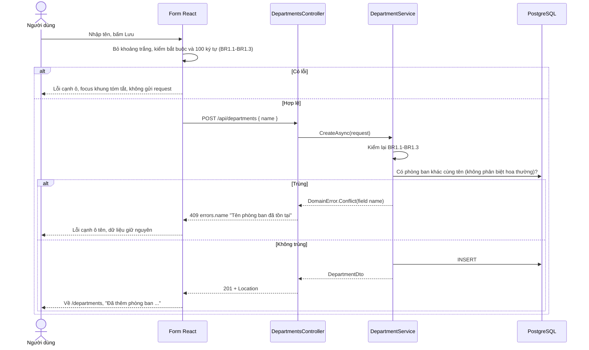
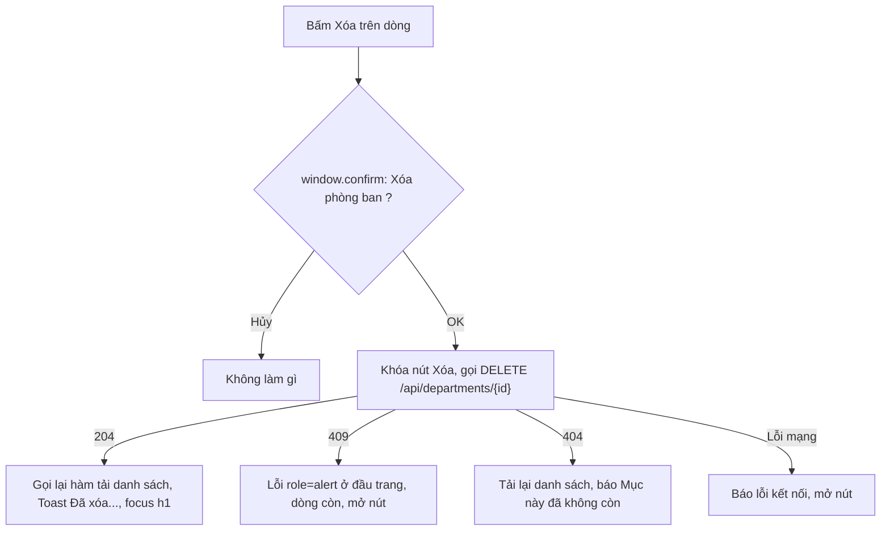
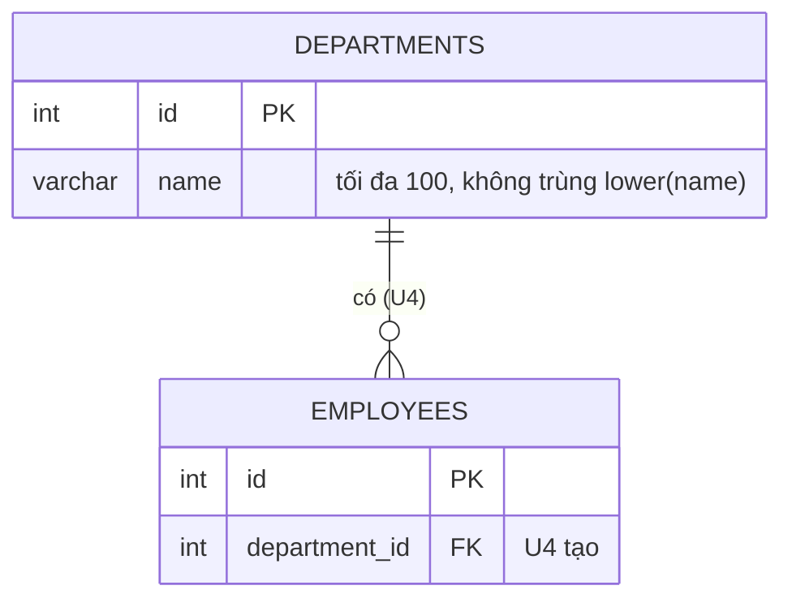

# Đặc tả chức năng: u3-departments

> **Nguồn:**
> - `inception/units-generation/unit-of-work.md` (U3), `unit-of-work-story-map.md`
> - `inception/user-stories/stories.md`: U3 làm **US1.1, US1.2, US1.3, US1.4 (AC1.4.1, AC1.4.2), US1.5 (AC1.5.1)** và phần phòng ban của US4.1, US4.2, US4.4–US4.6
> - `inception/requirements-analysis/requirements.md` (FR1, FR4, FR6), `inception/contract-design/contract-summary.md` (C1, C4, C5)
> - `inception/refined-mockups/` (mục 5–8, luồng F2, F3)
> - Phần nền đã có: U1 (`DomainError`, đổi lỗi sang ProblemDetails, `AppDbContext`), U2 (component, `client.ts`, `useSubmitGuard`, `Toast`)
>
> Thực thể ở `entities.md`, luật ở `rules.md`. File này là **nguồn chính cho các luồng và chuyển trạng thái** của U3.

## 1. U3 làm gì

- **Backend:** thực thể `Department` + cấu hình bảng; migration 1 (bảng `departments`, chỉ mục `ux_departments_name`, 4 phòng ban mẫu); DTO; `IDepartmentService` / `DepartmentService` (luật BR1, BR2); `DepartmentsController` cho 5 thao tác của C1; unit test cho service.
- **Frontend:** `src/api/departments.ts` (kiểu và hàm gọi API); trang danh sách `/departments`; form `/departments/new`, `/departments/:id/edit`; xóa có xác nhận.
- **Không làm:** bước kiểm "còn nhân viên" trước khi xóa (AC1.4.3) và bảng nhân viên trống (AC1.5.2) thuộc U4. U3 chỉ chuẩn bị đường dự phòng bắt lỗi khóa ngoại (BR2.5).

## 2. Luồng W1: xem danh sách (US1.1)

1. Trang `/departments` mở ra, hiện "Đang tải..." (BR4.1).
2. Giao diện gọi `GET /api/departments`.
3. API đọc mọi phòng ban, sắp theo tên A-Z (BR2.1), trả 200 + mảng `DepartmentDto`.
4. Mảng có phần tử → bảng + "Có N phòng ban". Mảng rỗng → "Chưa có phòng ban nào." + liên kết "Thêm phòng ban". Lỗi → "Không kết nối được máy chủ, vui lòng thử lại" + "Thử lại".

## 3. Luồng W2: thêm phòng ban (US1.2)

<!-- Text fallback: Người dùng nhập tên và bấm Lưu. Form kiểm trên trình duyệt; sai thì báo cạnh ô và không gửi. Đúng thì gửi POST. Service kiểm lại, rồi hỏi database có tên trùng không phân biệt hoa thường; trùng thì 409 và form báo cạnh ô; không trùng thì lưu, trả 201 và form quay về danh sách với thông báo đã thêm. -->

- Hai request chen nhau cùng vượt qua bước kiểm trùng: chỉ mục `ux_departments_name` của database chặn cái sau (23505); U1 đổi thành 409 `errors.name` (BR1.4, BR3.1).

## 4. Luồng W3: sửa phòng ban (US1.3)

1. Mở `/departments/:id/edit`: form hiện "Đang tải...", gọi `GET /api/departments/{id}`.
   - 200 → điền sẵn tên. 404 → "Không tìm thấy phòng ban" + liên kết về danh sách (BR4.3).
2. Người dùng sửa, bấm Lưu: kiểm như W2, gọi `PUT /api/departments/{id}`.
3. Service: không có id → 404 (BR2.2); kiểm trùng **loại trừ chính nó** (BR1.4: giữ nguyên tên hay chỉ đổi hoa thường vẫn lưu được); lưu, trả 200.
4. Thành công → về danh sách, "Đã cập nhật phòng ban ...". 404 khi lưu → khung tóm tắt "Không tìm thấy phòng ban, có thể đã bị xóa".

## 5. Luồng W4: xóa phòng ban (US1.4)

<!-- Text fallback: Bấm Xóa thì trình duyệt hỏi xác nhận. Hủy thì không làm gì. OK thì khóa nút và gọi DELETE: 204 thì tải lại danh sách, hiện thông báo đã xóa và focus về tiêu đề; 409 thì hiện lỗi ở đầu trang và giữ dòng; 404 thì tải lại và báo mục đã không còn; lỗi mạng thì báo lỗi kết nối và mở lại nút. -->

- Service xóa: không có id → 404; xóa dòng; nếu database báo 23503 trên `fk_employees_department` (chỉ xảy ra từ U4) → `DomainError.Conflict` title "Không thể xóa phòng ban", detail có tên phòng ban (BR2.5).

## 6. Luồng W5: dữ liệu mẫu (US1.5)

1. Hiệp chạy `dotnet ef database update` (database đã nối ở U1, W4).
2. Migration 1 tạo bảng `departments`, chỉ mục `ux_departments_name` trên `lower(name)`, rồi chèn 4 phòng ban mẫu, để database tự cấp id (BR3.2).
3. Mở trang Phòng ban thấy: Kế toán, Kinh doanh, Kỹ thuật, Nhân sự.

## 6b. Change Request 03/11/2026: gợi ý quy ước tên (US6.5)

Form thêm và sửa phòng ban có dòng gợi ý dưới ô tên (BR4.8). Không đổi luồng W1–W5, không đổi API.

## 7. Trạng thái

`Department` không có vòng đời (chỉ có hoặc không có), nên **không có máy trạng thái thực thể**. Trạng thái màn hình theo khung của U2:

| Màn hình | Trạng thái |
|---|---|
| Danh sách | loading → data / empty / error; error → loading khi bấm "Thử lại"; data → loading sau khi xóa |
| Form | (sửa) loading → default / not-found; default → submitting → (về danh sách) hoặc default có lỗi |

## 8. Sơ đồ quan hệ thực thể (lấy từ `entities.md`)

<!-- Text fallback: Bảng departments có id là khóa chính và name tối đa 100 ký tự, không trùng khi so chữ thường. Bảng employees (U4 tạo) tham chiếu departments qua department_id; một phòng ban có không hoặc nhiều nhân viên. -->

## 9. Tóm tắt luật (lấy từ `rules.md`)

| Nhóm | Luật | Ý chính |
|---|---|---|
| Dữ liệu | BR1.1–BR1.4 | Trim, bắt buộc, ≤ 100, không trùng (không phân biệt hoa thường) |
| Service, API | BR2.1–BR2.6 | Danh sách A-Z, 404, mã thành công, xóa hẳn, 409 khi còn nhân viên, `ExistsAsync` |
| Database | BR3.1–BR3.2 | Bảng `departments`, `ux_departments_name`, 4 phòng ban mẫu |
| Giao diện | BR4.1–BR4.7 | 4 trạng thái, kiểm form, sửa, lưu xong, xóa, khóa nút, nhãn nút |

## 10. Điểm cần kiểm thật ở Code Generation / Build and Test

| Điểm | Vì sao cần kiểm | Cách kiểm |
|---|---|---|
| So không phân biệt hoa thường với chữ có dấu ("KẾ TOÁN" và "Kế toán") | `lower()` của PostgreSQL và `ToLower()` của .NET phải cùng xử lý chữ tiếng Việt có dấu | Unit test service + Postman PUT "KẾ TOÁN" (AC1.3.2) + SQL tay chèn trùng (AC5.3.3) |
| Thứ tự A-Z tiếng Việt ("Kế toán" trước "Kinh doanh") | Thứ tự phụ thuộc collation của database (`English_United States.1252`) | Mở trang Phòng ban sau migration, so với AC1.1.1 và mockup mục 5 |
| Dữ liệu mẫu không làm hỏng số tự tăng | Chèn kèm id cố định có thể làm phòng ban thêm sau bị trùng id | Thêm một phòng ban mới ngay sau migration: phải 201 |

## 11. Kiểm như thế nào

| Kiểm | Cách làm | Luật |
|---|---|---|
| Unit test service | `dotnet test`: tạo, trùng (kể cả khác hoa thường), sửa giữ tên mình, 404, rỗng, quá 100, xóa, `ExistsAsync`, 23503 khi xóa | BR1, BR2 |
| Postman | Đủ 5 thao tác của C1: mã 200/201+Location/200/204, 400/404/409 | BR2.2, BR2.3, AC5.2.2, AC5.2.3 |
| pgAdmin | Bảng `departments`, cột `snake_case`, chỉ mục `ux_departments_name`, 4 dòng mẫu | BR3, AC1.5.1, AC5.3.2 |
| Trình duyệt | Danh sách, thêm, sửa, xóa; trạng thái tải / lỗi (tắt backend) / trống; bấm đúp Lưu; lỗi trùng; CORS thật từ 5173 | BR4, U2 việc chuyển sang |
