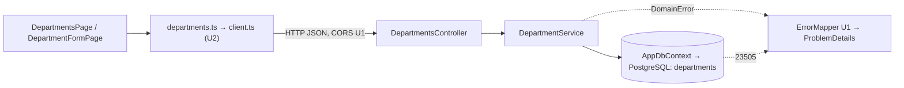

# Thành phần logic: u3-departments

> **Nguồn:** `nfr-requirements/tech-stack-decisions.md` (NFR6.4–NFR6.6), `functional-design/functional-spec.md` (mục 1), `functional-design/frontend-components.md`, `contract-summary.md` (C1, C3, C5).

## 1. Danh sách thành phần

| Thành phần | Vị trí | Việc | NFR áp vào |
|---|---|---|---|
| `Department` + `DepartmentConfiguration` | `backend/EmployeeCrud.Api/Departments/` | Thực thể EF Core; `ToTable("departments")`, `HasColumnName`, `HasMaxLength(100)` (NFR6.5) | NFR3.2 |
| `DepartmentDto`, `DepartmentRequest` | cùng thư mục | Hình dạng JSON của C1; `[Required]` trên `Name` | NFR2.2 |
| `IDepartmentService` / `DepartmentService` | cùng thư mục | Luật BR1, BR2; bắt tranh chấp và 23503; `ExistsAsync` cho U4 | NFR2.2, NFR3.3, NFR5.3, NFR5.6 |
| `DepartmentsController` | cùng thư mục | 5 thao tác của C1; chỉ chuyển request sang service, không chứa luật | NFR6.4 |
| Migration `CreateDepartments` | `backend/EmployeeCrud.Api/Migrations/` | Bảng, chỉ mục viết tay, 4 dòng mẫu | NFR1.1, NFR3.1, NFR3.4, NFR3.5 |
| `DepartmentServiceTests`, `ThrowingAppDbContext` | `backend/EmployeeCrud.Api.Tests/Departments/` | Unit test trên InMemory; ngữ cảnh ném lỗi giả | NFR4.1–NFR4.6 |
| Tool manifest | `dotnet-tools.json` (gốc dự án, nơi đã có `dotnet-ef`) | Thêm `dotnet-reportgenerator-globaltool` (cục bộ) | NFR4.2 |
| `src/api/departments.ts` | `frontend/` | Kiểu `Department`, `DepartmentRequest`; hàm gọi API dựa trên `client.ts` (NFR6.6) | NFR5.4 |
| `DepartmentsPage`, `DepartmentFormPage`, `validateDepartment` | `frontend/src/pages/departments/` | Danh sách, form thêm/sửa, kiểm form | NFR2.5 |

Đăng ký trong `Program.cs`: thêm một dòng `AddScoped<IDepartmentService, DepartmentService>()`. `AppDbContext` tự nhận `DepartmentConfiguration` nhờ `ApplyConfigurationsFromAssembly` của U1, nên không phải sửa.

<!-- Text fallback: Trang phòng ban gọi departments.ts, file này dùng client.ts của U2 để gửi HTTP JSON qua CORS của U1 tới DepartmentsController. Controller gọi DepartmentService, service đọc ghi bảng departments qua AppDbContext. Lỗi nghiệp vụ (DomainError) và lỗi trùng 23505 đi qua ErrorMapper của U1 để thành ProblemDetails. -->

## 2. Vùng lỗi và phạm vi ảnh hưởng

| Sự cố | Ảnh hưởng tới đâu | Vì sao chỉ tới đó |
|---|---|---|
| Một request phòng ban lỗi | Chỉ request đó | Service Scoped, không giữ trạng thái (NFR5.6) |
| Database tắt | Mọi request có dùng database trả 500; giao diện hiện "Không kết nối được máy chủ" + "Thử lại" | Không tự thử lại (U1 reliability §3) |
| Migration 1 hỏng | Cả phòng ban và nhân viên (U4 cần bảng này cho khóa ngoại) | Là nền dữ liệu của U4. Phải chạy được cả lên lẫn quay lui (NFR1.1) trước khi qua U4 |
| Bỏ hoặc đổi tên chỉ mục `ux_departments_name` | Trùng tên khi chen nhau sẽ thành 500 thay vì 409 | U1 nhận ra lỗi theo đúng tên ràng buộc |

## 3. Tài nguyên dùng chung với các Unit khác

- **Dùng của U1:** `AppDbContext`, `DomainError`, `ErrorMapper`, `DbConstraintNames`, chính sách CORS, user-secrets.
- **Dùng của U2:** `client.ts`, `useSubmitGuard`, `Toast`, `DataTable`, `FormField`, `ErrorSummary`, `usePageTitle`.
- **Cho U4 dùng:** bảng `departments` (khóa ngoại), `IDepartmentService.ExistsAsync` và `GetAllAsync` (ô chọn phòng ban), `src/api/departments.ts`.
- **U3 không sửa file nào của U1 hay U2**, chỉ thêm khóa log SQL vào `appsettings.Development.json` nếu U1 chưa có.
