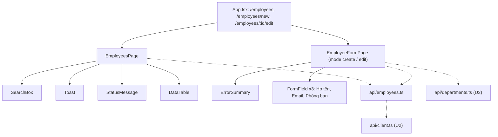

# Component giao diện: u4-employees

> **Nguồn:** `inception/refined-mockups/` (`mockups.md` mục 2–4, `interaction-spec.md` luồng F1–F4, mục 2.4 `SearchBox`, 2.5 form), `rules.md` (BR4.x), phần dùng chung của U2 (`client.ts`, `StatusMessage`, `Toast`, `DataTable`, `FormField`, `ErrorSummary`, `splitErrors`, `useSubmitGuard`, `usePageTitle`, CSS `.search`), của U3 (`src/api/departments.ts`, `.page-header`, `.list-count`, cách làm trang phòng ban), `functional-design-questions.md` (Q2, Q3).
>
> TypeScript `strict`. Mọi chữ hiển thị tiếng Việt.

## 1. Cây component

<!-- Text fallback: App có ba đường dẫn nhân viên. Trang danh sách dùng SearchBox, Toast, StatusMessage, DataTable. Trang form dùng ErrorSummary và ba FormField. Cả hai gọi api/employees.ts; form gọi thêm api/departments.ts của U3 để nạp ô chọn. Mọi lời gọi đi qua client.ts của U2. -->

## 2. File dự kiến

| File | Nội dung |
|---|---|
| `src/api/employees.ts` | `type Employee = { id; fullName; email; departmentId; departmentName }`; `type EmployeeRequest = { fullName; email; departmentId }`; `getEmployees(search, signal?)`, `getEmployee(id, signal?)`, `createEmployee`, `updateEmployee`, `deleteEmployee` |
| `src/components/SearchBox.tsx` | Form tìm dùng chung (interaction-spec 2.4) |
| `src/pages/employees/EmployeesPage.tsx` | Thay trang chỉ có tiêu đề của U2 (dời từ `src/pages/EmployeesPage.tsx`) |
| `src/pages/employees/EmployeeFormPage.tsx` | Form thêm và sửa |
| `src/pages/employees/validateEmployee.ts` | Hàm thuần kiểm 3 ô, trả `FieldErrors`; chứa luật định dạng email dùng chung (Q2) |
| `src/App.tsx` | Thêm hai đường dẫn form, import từ thư mục mới |

## 3. `SearchBox`

| Prop | Kiểu | Ý nghĩa |
|---|---|---|
| `initialValue` | `string` | Chuỗi trên địa chỉ (`?search=`) |
| `onSearch` | `(value: string) => void` | Gọi khi bấm Tìm hoặc Enter, nhận chuỗi đã trim |
| `disabled` | `boolean` | Khóa khi đang tải |

- `<form role="search" className="search">`, `<label htmlFor="tim-kiem">Tìm theo họ tên hoặc email</label>`, `<input id="tim-kiem" type="search">`, nút "Tìm".
- State nội bộ `value`; đồng bộ lại khi `initialValue` đổi (Back/Forward).

## 4. `EmployeesPage`

| Trạng thái (state) | Kiểu | Ý nghĩa |
|---|---|---|
| `status` | `"loading" \| "error" \| "ready"` | Trạng thái tải |
| `employees` | `Employee[]` | Dữ liệu |
| `loadError` | `string` | Lời báo khi tải lỗi |
| `actionError` | `string` | Lỗi khi xóa (lỗi mạng), `role="alert"` ở đầu trang |
| `deletingId` | `number \| null` | Dòng đang xóa |

- **Chuỗi tìm** lấy từ `useSearchParams()` (không lưu state riêng): địa chỉ là nguồn đúng duy nhất, nên Back/F5 tự đúng.
- **Tải:** effect phụ thuộc chuỗi tìm; hủy lời gọi cũ khi chuỗi đổi hoặc rời trang. Dùng `.then(...)` như trang phòng ban (luật lint `set-state-in-effect`).
- **Đầu trang:** `.page-header` với `h1` "Nhân viên" và liên kết "+ Thêm nhân viên"; `SearchBox`; `Toast`; khung `actionError`.
- **Bảng:** caption "Danh sách nhân viên"; cột "Họ tên", "Email", "Phòng ban"; nút "Sửa" (`aria-label="Sửa nhân viên <tên>"`), "Xóa" (`aria-label="Xóa nhân viên <tên>"`).
- **Dòng đếm** (`aria-live="polite"`): "Có N nhân viên" hoặc "Đang hiện N nhân viên" khi có chuỗi tìm.
- **Trống:** không tìm → "Chưa có nhân viên nào." + "Thêm nhân viên"; đang tìm → "Không tìm thấy nhân viên phù hợp với "<chuỗi>"." + nút "Xóa tìm kiếm" (đưa về `/employees`).
- **Xóa:** như trang phòng ban (BR4.7); tải lại giữ chuỗi tìm.

## 5. `EmployeeFormPage`

| Trạng thái | Kiểu | Ý nghĩa |
|---|---|---|
| `values` | `{ fullName: string; email: string; departmentId: string }` | Giá trị 3 ô; `departmentId` là chuỗi của ô chọn ("" = chưa chọn) |
| `loadStatus` | `"loading" \| "ready" \| "not-found" \| "error"` | Tải nhân viên (sửa) |
| `departments` | `Department[]` | Danh sách cho ô chọn |
| `departmentsStatus` | `"loading" \| "ready" \| "error"` | Tải phòng ban |
| `touched` | `Record<field, boolean>` | Ô đã rời |
| `fieldErrors`, `summaryMessages` | | Như form phòng ban |

- **Tiêu đề:** "Thêm nhân viên" / "Sửa nhân viên". Route có `key` theo chế độ và theo `id` (rà soát U3: đổi id thì form được tạo mới).
- **Ô:**
  - Họ tên: `id="fullName"`, `maxLength={100}`.
  - Email: `id="email"`, `type="email"`, `maxLength={254}`, gợi ý "Ví dụ: ten@congty.vn".
  - Phòng ban: `<select id="departmentId">` với mục "-- Chọn phòng ban --".
  - Form `noValidate`; ô `autoComplete="off"`.
- **Ô Phòng ban (BR4.4):** loading → khóa; error → dòng lỗi + nút "Thử lại", nút Lưu khóa; rỗng → "-- Chưa có phòng ban --", khóa, dòng hướng dẫn + liên kết `/departments/new`.
- **Kiểm (`validateEmployee`):** khi rời ô (chỉ thay lỗi khi thấy sai, giữ lỗi API tới khi sửa ô, bài học U3) và khi bấm Lưu.
- **Lưu:** gửi `{ fullName: trim, email: trim, departmentId: Number(...) }`; xử lý lỗi như form phòng ban, với ba khóa `fullName`, `email`, `departmentId`.
- **Hủy:** liên kết về `/employees`.

## 6. Luật kiểm dữ liệu trên form (khớp API)

| Ô | Luật | Lời báo |
|---|---|---|
| Họ tên | Bắt buộc sau trim | "Vui lòng nhập họ tên" |
| Họ tên | ≤ 100 | "Họ tên tối đa 100 ký tự" |
| Email | Bắt buộc sau trim | "Vui lòng nhập email" |
| Email | ≤ 254 | "Email tối đa 254 ký tự" |
| Email | Định dạng (BR1.6) | "Email không đúng định dạng" |
| Phòng ban | Đã chọn | "Vui lòng chọn phòng ban" |
| Email (API 409) | Không trùng | "Email đã được sử dụng" |
| Phòng ban (API 400) | Đang có | "Phòng ban không tồn tại" |

## 7. Điểm tích hợp API

| Thao tác | Hàm | API | Xử lý lỗi |
|---|---|---|---|
| Danh sách / tìm | `getEmployees` | `GET /api/employees[?search=]` | network/server → StatusMessage error |
| Một nhân viên | `getEmployee` | `GET /api/employees/{id}` | 404 → not-found |
| Phòng ban cho ô chọn | `getDepartments` (U3) | `GET /api/departments` | lỗi → dòng lỗi cạnh ô + "Thử lại" |
| Thêm | `createEmployee` | `POST /api/employees` | 400/409 → cạnh ô |
| Sửa | `updateEmployee` | `PUT /api/employees/{id}` | 400/409 → cạnh ô; 404 → tóm tắt |
| Xóa | `deleteEmployee` | `DELETE /api/employees/{id}` | 404 → tải lại; mạng → alert |
