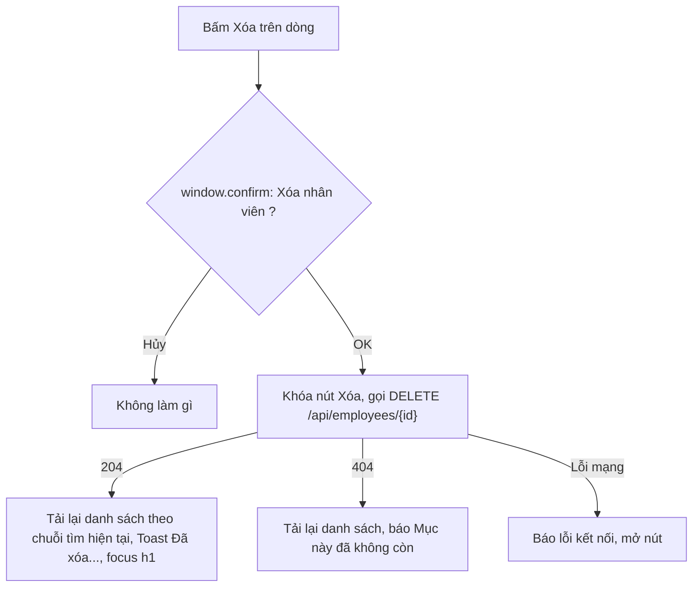
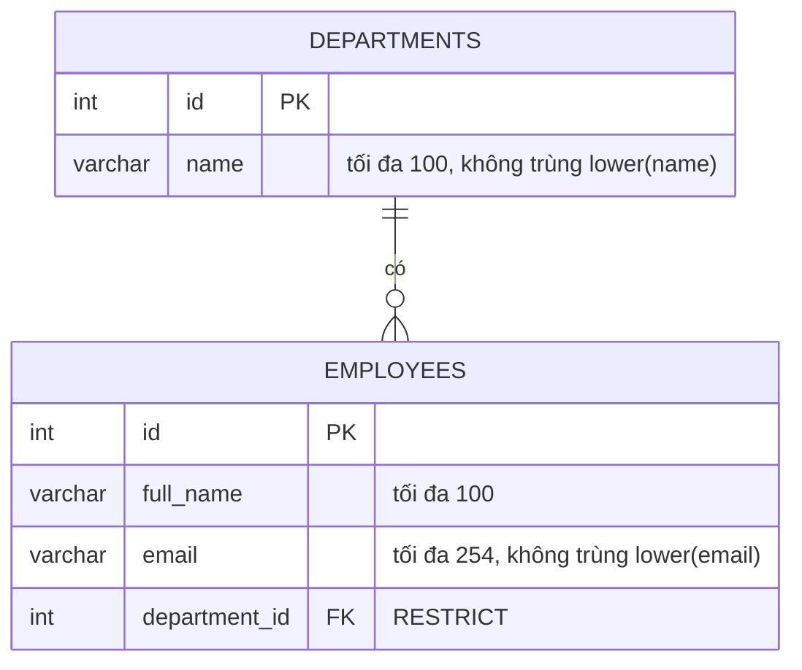

# Đặc tả chức năng: u4-employees

> **Nguồn:**
> - `inception/units-generation/unit-of-work.md` (U4), `unit-of-work-story-map.md`
> - `inception/user-stories/stories.md`: U4 làm **US2.1, US2.2, US2.3, US2.4, US3.1**, phần chặn xóa của **US1.4 (AC1.4.3)**, và phần nhân viên của US4.1, US4.2, US4.4–US4.6
> - `inception/requirements-analysis/requirements.md` (FR1.6, FR2, FR3, FR4), `inception/contract-design/contract-summary.md` (C2, C3, C4, C5)
> - `inception/refined-mockups/` (`mockups.md` mục 2–4, `interaction-spec.md` luồng F1–F4)
> - `functional-design-questions.md` (Q1–Q3)
> - Phần nền đã có: U1 (`DomainError`, đổi lỗi, `AppDbContext`, `DbConstraintNames`), U2 (component dùng chung, `client.ts`), U3 (`IDepartmentService`, bảng `departments`, `src/api/departments.ts`)
>
> Thực thể ở `entities.md`, luật ở `rules.md`. File này là **nguồn chính cho các luồng và chuyển trạng thái** của U4.

## 1. U4 làm gì

- **Backend:**
  - Thực thể `Employee` + cấu hình bảng.
  - Migration 2: bảng `employees`, chỉ mục `ux_employees_email`, khóa ngoại `fk_employees_department`, chỉ mục `department_id`.
  - DTO; `IEmployeeService` / `EmployeeService` (luật BR1, BR2.1–BR2.6) gọi `IDepartmentService.ExistsAsync` (C4).
  - `EmployeesController` cho 5 thao tác của C2, có `?search=`.
  - Bổ sung kiểm "còn nhân viên" vào `DepartmentService.DeleteAsync` (BR2.7).
  - Unit test cho cả hai service.
- **Frontend:**
  - `src/api/employees.ts`.
  - Trang `/employees` (danh sách + tìm kiếm), form `/employees/new`, `/employees/:id/edit`, xóa có xác nhận.
  - Component `SearchBox`.
- **Không làm:** lọc theo phòng ban, phân trang, tìm không dấu, nhân viên mẫu (requirements mục 7).

## 2. Luồng W1: xem danh sách và tìm kiếm (US2.1, US3.1)

```mermaid
sequenceDiagram
    actor U as Người dùng
    participant P as EmployeesPage
    participant A as EmployeesController
    participant S as EmployeeService
    participant D as PostgreSQL
    U->>P: Mở /employees?search=an (hoặc không có search)
    P->>P: Điền ô tìm từ địa chỉ, hiện "Đang tải..."
    P->>A: GET /api/employees?search=an
    A->>S: GetAllAsync("an")
    S->>S: Bỏ khoảng trắng; rỗng thì không lọc (BR2.2)
    S->>D: Nhân viên + tên phòng ban, lọc lower(full_name) hoặc lower(email) chứa "an", sắp họ tên rồi id
    D-->>S: Các dòng
    S-->>A: Danh sách EmployeeDto
    A-->>P: 200 + mảng
    alt Có dòng
        P-->>U: Bảng + "Có N nhân viên" / "Đang hiện N nhân viên"
    else Rỗng, không tìm
        P-->>U: "Chưa có nhân viên nào." + "Thêm nhân viên"
    else Rỗng, đang tìm
        P-->>U: "Không tìm thấy nhân viên phù hợp với "an"." + "Xóa tìm kiếm"
    end
```

<!-- Text fallback: Mở trang Nhân viên (có thể kèm ?search). Trang điền ô tìm từ địa chỉ, hiện đang tải, gọi GET /api/employees kèm search. Service bỏ khoảng trắng, lọc họ tên hoặc email chứa chuỗi (không phân biệt hoa thường), sắp theo họ tên rồi id, trả kèm tên phòng ban. Có dòng thì hiện bảng và dòng đếm; rỗng thì hiện chưa có nhân viên hoặc không tìm thấy tùy có đang tìm hay không. -->

- **Bấm Tìm hoặc Enter:** chuỗi đã trim được ghi lên địa chỉ (`?search=...`, rỗng thì bỏ tham số), trang tải lại theo địa chỉ. Back hoặc F5 giữ kết quả (BR4.2).
- **Lỗi mạng:** "Không kết nối được máy chủ, vui lòng thử lại" + "Thử lại" (gọi lại với cùng chuỗi tìm).

## 3. Luồng W2: thêm nhân viên (US2.2)

1. Mở `/employees/new`. Form gọi `GET /api/departments`; ô Phòng ban khóa tới khi nạp xong (BR4.4).
   - Nạp lỗi: lỗi cạnh ô + "Thử lại", nút Lưu khóa.
   - Không có phòng ban (Q3): "-- Chưa có phòng ban --", dòng hướng dẫn + liên kết `/departments/new`.
2. Người dùng nhập họ tên, email, chọn phòng ban, bấm Lưu.
3. Form kiểm (BR4.3). Có lỗi: lỗi cạnh từng ô, focus khung tóm tắt, không gửi.
4. Hợp lệ: `POST /api/employees` (nút "Đang lưu..." khóa).
5. Service kiểm lại theo thứ tự:
   1. BR1.1–BR1.6, BR1.8 (dữ liệu).
   2. BR1.9 phòng ban đang có (`ExistsAsync`) → không có thì 400 `departmentId`.
   3. BR1.7 email trùng (loại trừ chính nó khi sửa) → 409 `email`.
   4. Lưu.

   Kiểm dữ liệu trước vì rẻ và không chạm database; kiểm phòng ban trước email để lỗi 400 (dữ liệu sai) được báo trước lỗi 409 (xung đột).
6. 201 + Location → về `/employees`, "Đã thêm nhân viên "<tên>"" (BR4.6).
7. Lưu lúc chen nhau (BR2.6): 23505 email → 409 `email` (U1 đổi); 23503 phòng ban vừa bị xóa → 400 `departmentId` (U4 bắt).

## 4. Luồng W3: sửa nhân viên (US2.3)

1. Mở `/employees/:id/edit`: gọi song song `GET /api/employees/{id}` và `GET /api/departments`. Hiện "Đang tải..." tới khi cả hai xong.
   - 404 nhân viên → "Không tìm thấy nhân viên" + liên kết về danh sách. `:id` không phải số dương → coi như không tìm thấy, không gọi API.
2. Ba ô điền sẵn. Ô Phòng ban chọn sẵn phòng ban hiện tại.
3. Lưu: như W2 nhưng `PUT /api/employees/{id}`.
   - Service: không có id → 404.
   - Email trùng **loại trừ chính nó**: giữ email hay chỉ đổi hoa thường email của mình vẫn lưu được.
   - Lưu mà dòng vừa bị xóa ở nơi khác → 404.
4. 200 → về `/employees`, "Đã cập nhật nhân viên "<tên>"". 404 khi lưu → khung tóm tắt "Không tìm thấy nhân viên, có thể đã bị xóa".

## 5. Luồng W4: xóa nhân viên (US2.4)



<!-- Text fallback: Bấm Xóa thì hỏi xác nhận. Hủy thì không làm gì. OK thì khóa nút, gọi DELETE: 204 thì tải lại danh sách vẫn giữ chuỗi tìm, hiện đã xóa, focus về tiêu đề; 404 thì tải lại và báo mục đã không còn; lỗi mạng thì báo và mở lại nút. -->

## 6. Luồng W5: xóa phòng ban còn nhân viên (US1.4 AC1.4.3, phần U4)

1. Ở trang Phòng ban (U3), người dùng xác nhận xóa "Kế toán".
2. `DepartmentService.DeleteAsync`: tìm phòng ban (không có → 404) → **mới: có nhân viên thuộc phòng ban này không?** (BR2.7).
   - Có → 409 title "Không thể xóa phòng ban", detail "Không thể xóa phòng ban "Kế toán" vì vẫn còn nhân viên." Không xóa.
   - Không → xóa như U3. Nếu chen nhau có người vừa thêm nhân viên, khóa ngoại RESTRICT báo 23503 và đường dự phòng của U3 trả cùng lỗi 409.
3. Trang Phòng ban (U3 đã làm) hiện `detail` ở khung `role="alert"`, dòng vẫn còn.

## 7. Trạng thái

`Employee` không có vòng đời (chỉ có hoặc không có), nên **không có máy trạng thái thực thể**. Trạng thái màn hình:

| Màn hình | Trạng thái |
|---|---|
| Danh sách | loading → data / empty / no-match / error; error → loading khi "Thử lại"; mọi trạng thái → loading khi tìm, xóa tìm, hoặc sau khi xóa |
| Form | loading (sửa: nhân viên + phòng ban; thêm: phòng ban) → default / not-found; default → submitting → (về danh sách) hoặc default có lỗi |
| Ô Phòng ban | loading → ready / empty / error; error → loading khi "Thử lại" |

## 8. Sơ đồ quan hệ thực thể (lấy từ `entities.md`)



<!-- Text fallback: Bảng departments (id, name). Bảng employees (id, full_name tối đa 100, email tối đa 254 không trùng khi so chữ thường, department_id là khóa ngoại tới departments.id với RESTRICT). Một phòng ban có không hoặc nhiều nhân viên; mỗi nhân viên thuộc đúng một phòng ban. -->

## 9. Tóm tắt luật (lấy từ `rules.md`)

| Nhóm | Luật | Ý chính |
|---|---|---|
| Dữ liệu | BR1.1–BR1.9 | Trim; họ tên 1–100; email 1–254, đúng định dạng, không trùng (giữ như đã gõ); phòng ban bắt buộc và phải đang có |
| Service, API | BR2.1–BR2.7 | Danh sách sắp họ tên, tìm họ tên/email, 404, mã thành công, xóa hẳn, chen nhau, chặn xóa phòng ban còn nhân viên |
| Database | BR3.1–BR3.4 | Bảng `employees`, `ux_employees_email`, `fk_employees_department` RESTRICT, migration mới |
| Giao diện | BR4.1–BR4.9 | Trạng thái, tìm kiếm trên địa chỉ, kiểm form, ô chọn phòng ban, sửa, lưu, xóa, khóa nút, nhãn |

## 10. Điểm cần kiểm thật ở Code Generation / Build and Test

| Điểm | Vì sao | Cách kiểm |
|---|---|---|
| Tìm có chữ có dấu ("bình" ra "Trần Bình", "binh" không ra) | `lower()` PostgreSQL và cách so "chứa" phải giữ dấu | Unit test service + Postman `?search=binh`, `?search=%20b%C3%ACnh%20` |
| `%` và `_` không thành ký tự đại diện | Nếu viết bằng LIKE không thoát ký tự, "%" sẽ khớp mọi thứ | Postman `?search=%25` phải ra rỗng (khi không ai có "%") |
| Email trùng khác hoa thường bị chặn cả ở database | Chỉ mục `lower(email)` | SQL tay chèn "A@CongTy.vn" khi đã có "a@congty.vn" → 23505 |
| Xóa phòng ban còn nhân viên | BR2.7 + khóa ngoại thật (rà soát U3) | Postman `DELETE /api/departments/{id}` → 409; SQL tay `DELETE` → 23503 |
| Luật định dạng email giống hệt ở form và API | Q2 | Cùng bộ ví dụ hợp lệ/không hợp lệ ở unit test service và kiểm tay trên form |

## 11. Kiểm như thế nào

| Kiểm | Cách làm | Luật |
|---|---|---|
| Unit test `EmployeeService` | Tạo, trim, thiếu/quá dài từng trường, định dạng email, trùng email (khác hoa thường, loại trừ chính nó), phòng ban không có, tìm (hoa thường, email, khoảng trắng, không khớp, có dấu), 404, xóa, 23503 / tranh chấp | BR1, BR2.1–BR2.6 |
| Unit test `DepartmentService` (bổ sung) | Xóa phòng ban còn nhân viên → Conflict có tên; không còn → xóa được | BR2.7 |
| Postman | Đủ 5 thao tác C2 + `?search=`; 400/404/409; xóa phòng ban còn nhân viên → 409 | BR2, AC2.x, AC1.4.3 |
| pgAdmin | Bảng `employees`, cột snake_case, `ux_employees_email`, `fk_employees_department`, bảng trống sau migration | BR3, AC1.5.2 |
| Trình duyệt | Danh sách, tìm (Enter, nút, Back, F5, xóa tìm), thêm, sửa, xóa, ô phòng ban (nạp, rỗng, lỗi), bấm đúp Lưu, tắt backend | BR4 |
