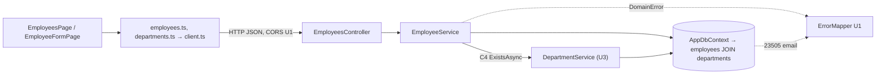

# Thành phần logic: u4-employees

> **Nguồn:** `nfr-requirements/tech-stack-decisions.md` (NFR6.4–NFR6.6), `functional-design/functional-spec.md` (mục 1), `functional-design/frontend-components.md`, `contract-summary.md` (C2, C4, C5).

## 1. Danh sách thành phần

| Thành phần | Vị trí | Việc | NFR áp vào |
|---|---|---|---|
| `Employee` + `EmployeeConfiguration` | `backend/EmployeeCrud.Api/Employees/` | Thực thể (có điều hướng `Department`); bảng, cột, khóa ngoại tên hằng, chỉ mục `department_id` | NFR3.2, NFR3.3, NFR3.8, NFR6.5 |
| `EmployeeDto`, `EmployeeRequest` | cùng thư mục | Hình dạng JSON của C2 | NFR2.2 |
| `IEmployeeService` / `EmployeeService` | cùng thư mục | BR1, BR2.1–BR2.6; luật email; bắt 23503 / tranh chấp | NFR2.2, NFR2.3, NFR3.4, NFR3.6, NFR5.3 |
| `EmployeesController` | cùng thư mục | 5 thao tác C2 + `?search=` | NFR6.4 |
| `DepartmentService` (sửa) | `backend/EmployeeCrud.Api/Departments/` | Kiểm còn nhân viên trước khi xóa (BR2.7) | NFR3.5 |
| `AppDbContext` (sửa) | `Platform/Data/` | Thêm `DbSet<Employee> Employees` | — |
| Migration `CreateEmployees` | `backend/EmployeeCrud.Api/Migrations/` | Bảng, khóa ngoại, chỉ mục, chỉ mục email viết tay | NFR1.1–NFR1.3, NFR3.1, NFR3.7 |
| `TestSupport/` (dời từ `Departments/`) | `backend/EmployeeCrud.Api.Tests/` | `TestDb`, `ThrowingAppDbContext` dùng chung | NFR4.7 |
| `EmployeeServiceTests`, `DepartmentServiceTests` (thêm ca) | `backend/EmployeeCrud.Api.Tests/` | Unit test | NFR4.1–NFR4.3 |
| `src/api/employees.ts` | `frontend/` | Kiểu và 5 hàm gọi API | NFR6.6 |
| `SearchBox` | `frontend/src/components/` | Form tìm dùng chung | NFR5.5 |
| `EmployeesPage`, `EmployeeFormPage`, `validateEmployee` | `frontend/src/pages/employees/` | Danh sách + tìm, form, kiểm form (luật email BR1.6) | NFR2.5 |

Đăng ký trong `Program.cs`: thêm `AddScoped<IEmployeeService, EmployeeService>()`.

<!-- Text fallback: Trang nhân viên gọi employees.ts (và departments.ts cho ô chọn) qua client.ts tới EmployeesController. Controller gọi EmployeeService; service hỏi DepartmentService (U3) xem phòng ban có tồn tại không, rồi đọc ghi bảng employees qua AppDbContext. Lỗi nghiệp vụ và lỗi trùng email đi qua ErrorMapper của U1. DepartmentService cũng đọc bảng employees để chặn xóa phòng ban còn nhân viên. -->

## 2. Vùng lỗi và phạm vi ảnh hưởng

| Sự cố | Ảnh hưởng tới đâu | Vì sao chỉ tới đó |
|---|---|---|
| Một request nhân viên lỗi | Chỉ request đó | Service Scoped, không giữ trạng thái |
| Database tắt | Mọi request dùng database trả 500; trang hiện "Không kết nối được máy chủ" + "Thử lại" | Không tự thử lại (U1) |
| Migration 2 hỏng | Chỉ phần nhân viên; quay về `CreateDepartments` thì phòng ban còn nguyên | Migration riêng, `Down` chỉ xóa phần của U4 |
| Đổi tên khóa ngoại hay chỉ mục email | Lỗi chen nhau thành 500 hoặc lời báo chung | Tên lấy từ hằng U1 (khóa ngoại) và khớp hằng (chỉ mục email) |
| Sửa `DepartmentService.DeleteAsync` sai | Trang phòng ban (U3) bị ảnh hưởng | Có unit test cho cả hai trường hợp; chạy lại test phòng ban |

## 3. Tài nguyên dùng chung

- **Dùng của U1:** `AppDbContext`, `DomainError`, `ErrorMapper`, `DbConstraintNames`, CORS.
- **Dùng của U2:** `client.ts`, `DataTable`, `FormField`, `ErrorSummary`, `StatusMessage`, `Toast`, `useSubmitGuard`, `usePageTitle`, CSS `.search`.
- **Dùng của U3:** `IDepartmentService.ExistsAsync`, bảng `departments`, `src/api/departments.ts`, `.page-header`, `.list-count`, hạ tầng test (dời sang `TestSupport/`), script `coverage`.
- **Sửa file của U2/U3:** `App.tsx` (đường dẫn), `EmployeesPage.tsx` (dời sang `pages/employees/`), `DepartmentService.cs` (BR2.7), `AppDbContext.cs`, `Program.cs`, `TestDb.cs` / `ThrowingAppDbContext.cs` (dời chỗ).
