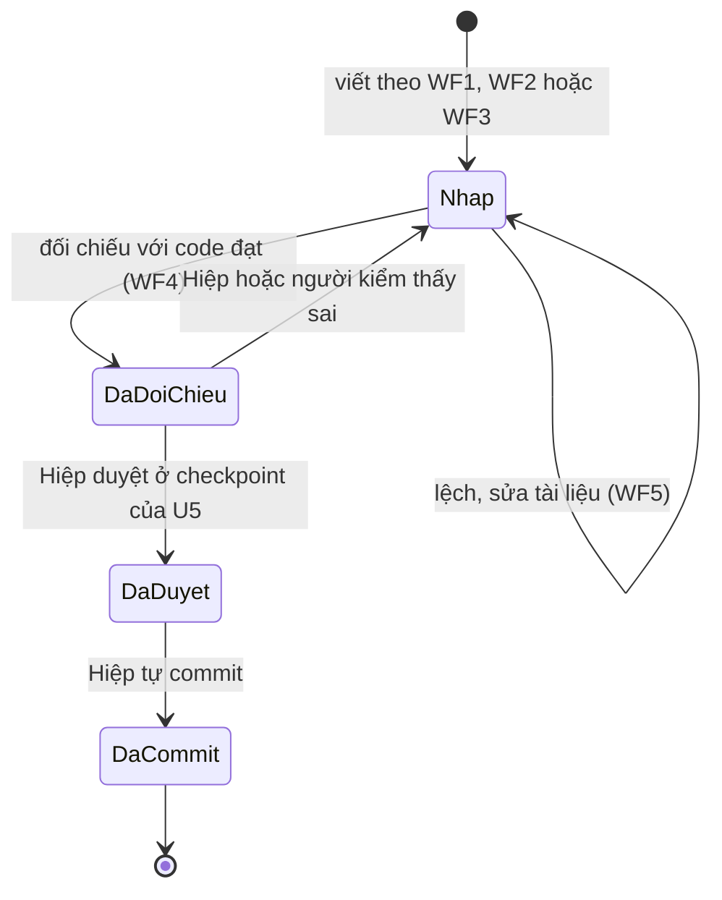
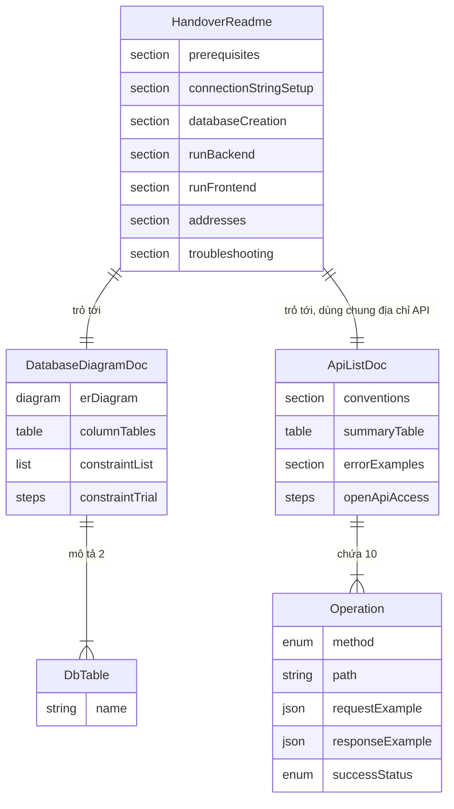

# Đặc tả chức năng — U5 `u5-handover`

> **Nguồn:**
> - `inception/units-generation/unit-of-work.md` §U5: làm README → sơ đồ DB → danh sách API → đối chiếu với code; không viết code ứng dụng.
> - `inception/units-generation/unit-of-work-story-map.md`: U5 lo US5.1 (chia với U1), US5.2 (chia với U1), US5.3; thứ tự trong unit "README → sơ đồ DB → danh sách API → đối chiếu với code".
> - `inception/user-stories/stories.md`: unit này làm **US5.1, US5.2, US5.3** (AC5.1.1–AC5.3.3).
> - `inception/requirements-analysis/requirements.md`: FR7.1–FR7.4, FR6.1–FR6.4, FR4.3–FR4.4, NFR1–NFR3.
> - `inception/domain-design/components.md`: U5 không thuộc khối nào; tài liệu mô tả lại các khối Platform, DepartmentManagement, EmployeeManagement, WebUi.
> - `inception/contract-design/contract-summary.md`: C1, C2 (10 thao tác), C3 (phong bì lỗi chung), §4 (cổng thật lấy từ cấu hình; U5 phải ghi đúng).
> - `entities.md`, `rules.md` của unit này (nguồn đúng cho hình dạng tài liệu và luật).
> - `functional-design-questions.md`: Q1–Q5, Hiệp chọn A cả năm.

## 1. Phạm vi

- **Làm:** ba file `README.md`, `docs/so-do-database.md`, `docs/danh-sach-api.md` (Q1 = A), viết tiếng Việt; đối chiếu từng mục với code đang chạy.
- **Không làm:** không sửa code ứng dụng, migration hay cấu hình (BR4.1). Ba việc còn mở từ U1–U4 chuyển cho Build and Test (Q5 = A).
- **Phần của U1 trong US5.1, US5.2** (user-secrets, tool manifest, OpenAPI, ProblemDetails) đã làm xong; U5 chỉ ghi lại cách dùng và kiểm lại.

## 2. Các luồng làm việc (nguồn đúng cho thứ tự)

### WF1. Viết README (BR1.1–BR1.6, BR4.2)

1. Gom nháp đã có: phần cài backend (U1), cài frontend (U2), lệnh migration và lưu ý Smart App Control (U3, U4).
2. Đọc phiên bản đích từ file dự án backend và `package.json`; đọc phiên bản đã cài trên máy làm bài (BR1.2).
3. Đọc địa chỉ, cổng từ cấu hình chạy của backend, cấu hình Vite và biến địa chỉ API của frontend (BR1.5).
4. Viết các mục theo đúng thứ tự trong `entities.md` → `HandoverReadme`: giới thiệu → phần mềm cần có → lấy mã nguồn → đặt connection string → khôi phục công cụ → tạo database → chạy backend → chạy frontend → địa chỉ → kiểm nhanh → chạy test → sự cố thường gặp → tài liệu khác.
5. Ví dụ connection string chỉ dùng chữ giữ chỗ cho mật khẩu (BR1.3).
6. Mục sự cố: chỉ các lỗi đã gặp thật (BR1.6, Q2 = A).

### WF2. Viết sơ đồ database (BR2.1–BR2.4)

1. Đọc migration và snapshot model để lấy tên bảng, cột, kiểu, ràng buộc, dữ liệu mẫu (BR2.2).
2. Vẽ sơ đồ mermaid `erDiagram` hai bảng, kèm đoạn mô tả bằng chữ thay thế.
3. Viết bảng mô tả cột cho từng bảng và danh sách ràng buộc kèm tên thật (BR2.3).
4. Viết hai thử nghiệm ràng buộc; chạy thử thật để ghi đúng mã lỗi PostgreSQL, rồi trả dữ liệu về như cũ (BR2.4). Câu lệnh thử do Hiệp chạy trong pgAdmin (AI không gõ mật khẩu database).
5. Hiệp mở pgAdmin đối chiếu tên bảng, cột, ràng buộc với tài liệu (AC5.3.2).

### WF3. Viết danh sách API (BR3.1–BR3.5)

1. Dừng mọi backend đang chạy nền (tránh khóa file khi build), rồi chạy backend ở Development.
2. Gọi lần lượt 10 thao tác của C1, C2 bằng lệnh PowerShell với dữ liệu mẫu tiếng Việt; chép mã trạng thái, header `Location` (khi 201) và body thật (BR3.2, BR3.3, Q4 = A).
3. Gọi các ca lỗi: 400 (dữ liệu sai), 404 (id không tồn tại), 409 (trùng tên phòng ban, trùng email, xóa phòng ban còn nhân viên); chép `Content-Type` và body (BR3.4).
4. Mở trang OpenAPI, đếm đủ 10 thao tác (BR3.5).
5. Xóa các bản ghi tạo ra để thử; database về đúng trạng thái trước khi gọi (BR3.2).
6. Viết danh sách theo khuôn `Operation` trong `entities.md`; mục quy ước chung dùng cùng địa chỉ API với README (BR1.5).
7. Dừng backend.

### WF4. Đối chiếu với code (BR4.1, BR4.3, BR4.4)

1. **Postman:** Hiệp gọi ít nhất một GET, POST, PUT, DELETE và một ca lỗi; so mã và body với danh sách (BR4.4).
2. **pgAdmin:** như WF2 bước 5.
3. **Bản clone sạch:** Hiệp `git clone` repo sang thư mục ngoài dự án, làm theo README từng bước; AI hướng dẫn (BR4.3, Q3 = A). Kết thúc bằng một lượt thêm, sửa, xóa, tìm trên giao diện (AC5.1.3).
4. Ghi kết quả đối chiếu (ngày, lệnh, mã nhận được, hạn chế "cùng máy") vào `code-summary.md` của U5, không ghi vào ba tài liệu bàn giao.

Điều kiện trước bước 3: ba tài liệu và mọi thay đổi khác phải đã được Hiệp commit, vì clone chỉ lấy những gì đã commit.

### WF5. Xử lý khi tài liệu lệch với code (BR3.3, BR4.1)

1. Thấy lệch → dừng lại, báo Hiệp chỗ lệch.
2. Tài liệu sai → sửa tài liệu, đối chiếu lại mục đó.
3. Code khác hợp đồng (ví dụ mã trạng thái khác FR6.2) → tài liệu ghi hành vi thật, việc sửa code ghi vào việc còn mở cho Build and Test; không sửa code trong U5.
4. README vướng khi Hiệp làm theo → sửa README, Hiệp làm lại từ bước vướng.

## 3. Vòng đời của mỗi tài liệu

<!-- Text fallback: Mỗi tài liệu đi từ Nháp sang Đã đối chiếu khi khớp với code; lệch thì quay lại Nháp để sửa. Đã đối chiếu mà bị phát hiện sai thì về Nháp. Hiệp duyệt ở checkpoint thì thành Đã duyệt, Hiệp tự commit thì thành Đã commit. -->

| Trạng thái | Nghĩa | Ai chuyển |
|---|---|---|
| Nháp | Đã viết, chưa đối chiếu | AI viết |
| Đã đối chiếu | Khớp code, Postman, pgAdmin | AI gọi lệnh, Hiệp kiểm Postman và pgAdmin |
| Đã duyệt | Hiệp duyệt ở checkpoint U5 | Hiệp |
| Đã commit | Nằm trong Git | Hiệp tự commit (AI không commit, không push) |

Riêng README còn một lượt kiểm sau khi commit: bản clone sạch (WF4 bước 3). Nếu vướng thì README về Nháp, sửa, Hiệp commit lại.

## 4. Sơ đồ quan hệ (suy ra từ `entities.md`)

<!-- Text fallback: README trỏ tới sơ đồ database và danh sách API, dùng chung địa chỉ API với danh sách. Danh sách API chứa đúng 10 thao tác. Sơ đồ database mô tả hai bảng departments và employees (do U3, U4 tạo). -->

`DbTable` chỉ là hai bảng `departments`, `employees` có sẵn từ U3, U4; U5 không định nghĩa bảng mới.

## 5. Tóm tắt luật (suy ra từ `rules.md`)

- **README (BR1.1–BR1.6):** đủ phần FR7.4; phiên bản và địa chỉ lấy từ nguồn thật; không mật khẩu; lệnh chạy được từ gốc bản clone; sự cố chỉ ghi lỗi đã gặp.
- **Sơ đồ DB (BR2.1–BR2.4):** đủ bảng, cột, PK, FK, cột không trùng; khớp database sau migration; nêu ràng buộc kèm tên thật; có cách thử ràng buộc.
- **Danh sách API (BR3.1–BR3.5):** đủ 10 thao tác; JSON thật; mã thành công đúng FR6.2; ví dụ lỗi 400/404/409; cách mở OpenAPI.
- **Cách làm (BR4.1–BR4.4):** không sửa code; tiếng Việt, giữ định danh; Hiệp tự kiểm bản clone sạch và kiểm lại bằng Postman.

## 6. Story và tiêu chí unit này lo

| Story (`stories.md`) | Tiêu chí | Lo bằng |
|---|---|---|
| US5.1 | AC5.1.1, AC5.1.2, AC5.1.3 | WF1, WF4 bước 3; BR1.1–BR1.6, BR4.3 |
| US5.2 | AC5.2.1–AC5.2.4 | WF3, WF4 bước 1; BR3.1–BR3.5, BR4.4 |
| US5.3 | AC5.3.1–AC5.3.3 | WF2, WF4 bước 2; BR2.1–BR2.4 |

## 7. Ca biên và rủi ro

- **Cùng máy không "sạch":** user-secrets và `employee_db` đã có sẵn, nên bản clone trên máy này không chứng minh được bước đặt user-secrets lần đầu. Ghi hạn chế này vào kết quả đối chiếu; Hiệp có thể thử bằng cách chạy lệnh đặt user-secrets lại (ghi đè giá trị cũ bằng giá trị đúng).
- **Database đã có dữ liệu:** hiện có 1 nhân viên "Đỗ Văn An" (id 1) và số tự tăng đã qua 2005; JSON mẫu sẽ mang id thật lúc gọi. Danh sách ghi rõ "id có thể khác trên máy bạn".
- **Smart App Control chặn file vừa build:** U5 không build code mới nên ít gặp. Nếu `dotnet run` vẫn bị chặn thì dừng lại báo Hiệp; không thêm comment vào code để né (cách đó là sửa code, trái BR4.1).
- **Thử ràng buộc làm bẩn dữ liệu:** mỗi thử nghiệm trả dữ liệu về như cũ (BR2.4, BR3.2).
