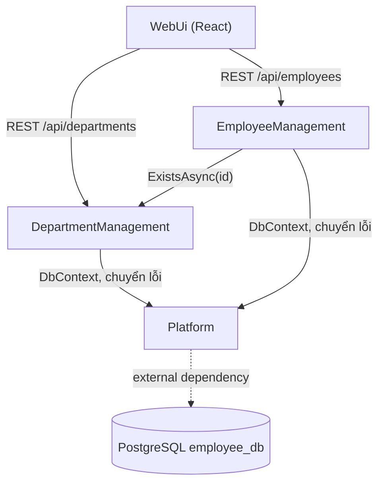

# Các khối logic (Component Catalogue)

> **Nguồn:**
> - `requirements-analysis/requirements.md` (FR1–FR7, NFR1–NFR8)
> - `user-stories/stories.md` (US1.1–US5.3)
> - `refined-mockups/interaction-spec.md`
> - `practices-discovery/team-practices.md`
> - `domain-design-questions.md` (Q1–Q4)
>
> Mỗi quyết định có ADR riêng trong `decisions.md`.
>
> **Khối là gì:** phần code mình tự viết, mỗi khối lo một việc. PostgreSQL là thứ các khối **dùng tới** (external dependency), không phải một khối. Bước này chưa quyết cách đóng gói để chạy; đó là việc của bước Units Generation.
>
> **Thực thể chỉ ghi ở mức ai sở hữu và có những trường nào.** Kiểu dữ liệu và luật kiểm thuộc bước Functional Design.

## Part A: Danh mục (machine-readable)

```yaml
components:
  - name: DepartmentManagement
    summary: Quản lý phòng ban - xem, thêm, sửa, xóa và các luật nghiệp vụ của phòng ban
    behaviour: >
      Danh sách sắp theo tên A-Z. Tên bắt buộc, bỏ khoảng trắng hai đầu, tối đa 100 ký tự,
      không trùng với phòng ban khác (so không phân biệt hoa thường) - trùng thì báo xung đột (409).
      Sửa giữ nguyên tên của chính nó không bị coi là trùng. Không tìm thấy id thì báo 404.
      Trước khi xóa, đếm (chỉ đọc) xem phòng ban còn nhân viên không; còn thì từ chối với 409 và
      lời báo tiếng Việt; khóa ngoại RESTRICT trong database là chốt chặn thứ hai (ADR-002).
      Cung cấp ExistsAsync(id) cho khối Nhân viên dùng (ADR-003).
    responsibilities:
      - Luật nghiệp vụ và kiểm dữ liệu của phòng ban (FR1.1-FR1.6)
      - API REST /api/departments (FR6.1)
      - Trả lời câu hỏi "phòng ban id X có tồn tại không" cho khối khác
    depends_on:
      - component: Platform
        interaction: Đọc/ghi phòng ban và đếm nhân viên qua DbContext dùng chung; ném lỗi nghiệp vụ để Platform chuyển thành ProblemDetails
        style: sync
    dependents:
      - component: EmployeeManagement
        interaction: Kiểm phòng ban tồn tại trước khi thêm/sửa nhân viên (ExistsAsync)
      - component: WebUi
        interaction: Gọi API REST /api/departments
    external_dependencies:
      - name: PostgreSQL
        kind: database
        purpose: Lưu bảng departments (qua DbContext của Platform)
    entities:
      - name: Department
        identifier: id
        attributes: [id, name]

  - name: EmployeeManagement
    summary: Quản lý nhân viên - xem, thêm, sửa, xóa và tìm kiếm nhân viên
    behaviour: >
      Danh sách sắp theo họ tên A-Z, mỗi dòng có tên phòng ban (lấy bằng JOIN của EF Core).
      Tìm kiếm: một chuỗi, bỏ khoảng trắng hai đầu, khớp khi họ tên HOẶC email chứa chuỗi đó,
      không phân biệt hoa thường, có phân biệt dấu; chuỗi rỗng thì trả tất cả.
      Họ tên bắt buộc tối đa 100 ký tự; email bắt buộc đúng định dạng tối đa 254 ký tự và không trùng
      với nhân viên khác (không phân biệt hoa thường) - trùng thì 409; sửa giữ nguyên email của chính mình không bị coi là trùng.
      Phòng ban bắt buộc và phải tồn tại - hỏi DepartmentManagement.ExistsAsync, không có thì 400 gắn với trường departmentId.
      Không tìm thấy id thì 404. Xóa là xóa hẳn.
    responsibilities:
      - Luật nghiệp vụ và kiểm dữ liệu của nhân viên (FR2.1-FR2.6)
      - Tìm kiếm theo họ tên hoặc email (FR3.1-FR3.2)
      - API REST /api/employees, gồm tham số search (FR6.1, FR6.3)
    depends_on:
      - component: DepartmentManagement
        interaction: Kiểm phòng ban tồn tại khi thêm/sửa nhân viên
        style: sync
      - component: Platform
        interaction: Đọc/ghi nhân viên qua DbContext dùng chung; ném lỗi nghiệp vụ để Platform chuyển thành ProblemDetails
        style: sync
    dependents:
      - component: WebUi
        interaction: Gọi API REST /api/employees
    external_dependencies:
      - name: PostgreSQL
        kind: database
        purpose: Lưu bảng employees (qua DbContext của Platform)
    entities:
      - name: Employee
        identifier: id
        attributes: [id, fullName, email, departmentId]
        references:
          - entity: Department
            owned_by: DepartmentManagement
            relationship: Mỗi nhân viên thuộc đúng một phòng ban; một phòng ban có nhiều nhân viên

  - name: Platform
    summary: Nền tảng chung của backend - kết nối database, migration và dữ liệu mẫu, chuyển lỗi thành ProblemDetails, cấu hình CORS và OpenAPI
    behaviour: >
      Một DbContext duy nhất (ADR-004) ánh xạ hai bảng theo kiểu snake_case khai báo tay (ToTable, HasColumnName),
      có chỉ mục không trùng cho email và tên phòng ban (không phân biệt hoa thường), khóa ngoại
      employees.department_id -> departments.id kiểu RESTRICT. Migration tạo bảng và 4 phòng ban mẫu, không có nhân viên mẫu.
      Connection string đọc từ user-secrets, không nằm trong file commit. Bắt mọi lỗi chưa xử lý và lỗi nghiệp vụ
      (không tìm thấy, xung đột, dữ liệu sai) rồi trả ProblemDetails với mã 400/404/409, lời báo tiếng Việt;
      lỗi vi phạm ràng buộc database cũng được chuyển thành 409/400 chứ không để lộ 500.
      Chỉ cho phép frontend ở địa chỉ phát triển của Vite gọi API (CORS). Bật tài liệu OpenAPI ở môi trường Development.
    responsibilities:
      - Cấu hình truy cập database dùng chung, migration, dữ liệu mẫu (FR1.7, FR7.1, NFR3)
      - Chuẩn lỗi ProblemDetails cho toàn bộ API (FR4.2-FR4.4)
      - CORS (NFR7), OpenAPI (FR6.4), bí mật kết nối qua user-secrets (NFR2)
    depends_on: []
    dependents:
      - component: DepartmentManagement
        interaction: Dùng DbContext và cơ chế chuyển lỗi
      - component: EmployeeManagement
        interaction: Dùng DbContext và cơ chế chuyển lỗi
    external_dependencies:
      - name: PostgreSQL
        kind: database
        purpose: Database employee_db (PostgreSQL 18, cổng 5432) chứa hai bảng departments và employees
    entities: []

  - name: WebUi
    summary: Giao diện web React (Vite) - hai trang danh sách, các form, tìm kiếm, xác nhận xóa, thông báo
    behaviour: >
      Theo refined-mockups: hai trang Nhân viên và Phòng ban chuyển bằng React Router, form thêm/sửa là trang riêng.
      Kiểm dữ liệu ngay trên form theo đúng luật của API (FR4.1), giữ dữ liệu đã gõ khi có lỗi.
      Ba trạng thái đang tải / lỗi kết nối / trống tách bạch (FR4.5). Khóa nút khi đang gửi (FR4.6).
      Mọi lời gọi API đi qua một module chung đọc ProblemDetails và hiện lời báo tiếng Việt.
      Không giữ dữ liệu nghiệp vụ lâu dài; chỉ hiển thị dữ liệu API trả về (không Redux).
      Code xếp theo tính năng: features/departments, features/employees, components dùng chung, api (ADR-005).
    responsibilities:
      - Mọi màn hình và tương tác người dùng (FR5.1-FR5.4, US1.x-US4.x)
      - Kiểm dữ liệu phía trình duyệt và hiển thị lỗi (FR4.1, FR4.5, FR4.6)
      - Đạt các mục tiêu chất lượng giao diện G1-G6 do Hiệp đặt ở Refined Mockups
    depends_on:
      - component: DepartmentManagement
        interaction: Gọi API REST /api/departments (danh sách, chi tiết, thêm, sửa, xóa; nạp ô chọn phòng ban)
        style: sync
      - component: EmployeeManagement
        interaction: Gọi API REST /api/employees (danh sách, tìm, chi tiết, thêm, sửa, xóa)
        style: sync
    dependents: []
    external_dependencies: []
    entities: []
```

## Part B: Bản cho người đọc

### Sơ đồ khối



<!-- Text fallback: WebUi gọi DepartmentManagement và EmployeeManagement qua REST. EmployeeManagement gọi DepartmentManagement để kiểm phòng ban tồn tại. Cả hai khối nghiệp vụ dùng Platform (DbContext dùng chung, chuyển lỗi). Platform kết nối PostgreSQL. Không có vòng phụ thuộc. -->

Luồng một request, ví dụ thêm nhân viên:
1. WebUi gửi `POST /api/employees`.
2. EmployeeManagement kiểm dữ liệu và hỏi DepartmentManagement xem phòng ban có tồn tại không.
3. EmployeeManagement ghi qua DbContext của Platform xuống PostgreSQL.
4. Nếu có lỗi, Platform trả về ProblemDetails.

### Tóm tắt các khối

| Component | Purpose | Depends On | Dependents | Entities Owned |
|---|---|---|---|---|
| DepartmentManagement | Luật và API của phòng ban | Platform | EmployeeManagement, WebUi | Department |
| EmployeeManagement | Luật, tìm kiếm và API của nhân viên | DepartmentManagement, Platform | WebUi | Employee |
| Platform | DbContext dùng chung, migration, dữ liệu mẫu, ProblemDetails, CORS, OpenAPI | — | DepartmentManagement, EmployeeManagement | — |
| WebUi | Giao diện React | DepartmentManagement, EmployeeManagement | — | — |

### Ai sở hữu thực thể nào

| Entity | Owning Component | Identifier | Attributes | References |
|---|---|---|---|---|
| Department | DepartmentManagement | id | id, name | — |
| Employee | EmployeeManagement | id | id, fullName, email, departmentId | Department (DepartmentManagement): mỗi nhân viên thuộc đúng một phòng ban |

### Thứ bên ngoài các khối dùng tới

| Component | Dependency | Kind | Purpose |
|---|---|---|---|
| Platform | PostgreSQL | database | Database `employee_db`, hai bảng `departments` và `employees` |
| DepartmentManagement | PostgreSQL | database | Bảng `departments`, đi qua DbContext của Platform |
| EmployeeManagement | PostgreSQL | database | Bảng `employees`, đi qua DbContext của Platform |

### Vì sao tách thành từng khối

| Component | Vì sao là một khối riêng |
|---|---|
| DepartmentManagement | Sở hữu riêng dữ liệu phòng ban. Có luật riêng (tên không trùng, chặn xóa khi còn nhân viên). Làm trước, vì nhân viên phụ thuộc vào nó (`team-practices.md`). |
| EmployeeManagement | Sở hữu riêng dữ liệu nhân viên. Có luật và chức năng riêng (email không trùng, tìm kiếm). Thay đổi theo nhịp riêng của phần nhân viên. |
| Platform | Lo những việc dùng chung, không thuộc luật nghiệp vụ nào: kết nối DB, lỗi chuẩn, CORS. Tách ra để hai khối nghiệp vụ không viết lặp lại, và để dễ giải thích "lỗi đi đâu, DB nối thế nào" ở một chỗ. |
| WebUi | Chạy ở nơi khác (trình duyệt, không phải máy chủ), dùng ngôn ngữ khác (JavaScript), có vòng đời build và chạy riêng (`npm run dev`). |

**Phương án đã cân nhắc nhưng không chọn** (chi tiết trong `decisions.md`):
- **Gộp Phòng ban và Nhân viên thành một khối "Quản lý nhân sự"** (Q1-B): ít ranh giới hơn, nhưng một khối ôm hai thực thể, luật của hai bên lẫn vào nhau và khó chia việc làm phòng ban trước.
- **Tách giao diện thành hai khối** (Q1-C): hai khối giao diện dùng chung khung trang, menu và module gọi API, nên gần như luôn phải sửa cùng lúc. Theo nguyên tắc "luôn đổi cùng nhau thì là một khối".

**Ghi chú về chỗ đọc chéo dữ liệu** (ADR-002): để chặn xóa phòng ban còn nhân viên, DepartmentManagement **đọc** (chỉ đếm, không ghi) bảng nhân viên qua DbContext dùng chung. Nhờ vậy sơ đồ không có vòng phụ thuộc, vì Nhân viên đã phụ thuộc Phòng ban. Đổi lại, khối Phòng ban biết tới bảng nhân viên. Hiệp đã chấp nhận điều này ở Q2.
