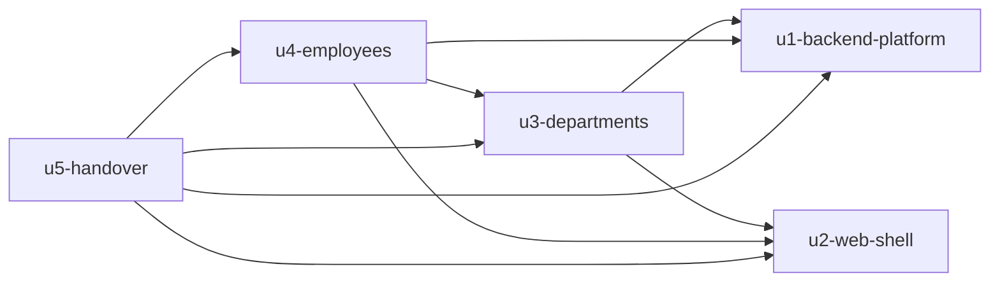

# Phụ thuộc giữa các unit (Dependency DAG)

> **Nguồn:** `unit-of-work.md`, `domain-design/components.md` (các cạnh `depends_on`), Q2 (giữ đúng phụ thuộc thật).
>
> File này chỉ mô tả **cấu trúc**: unit nào cần unit nào. Nó **không** chọn thứ tự làm và không chỉ ra đường găng (critical path); việc đó thuộc bước Delivery Planning.
>
> Cách hiểu "A phụ thuộc B": code hoặc test của A cần code của B mới build được hoặc chạy qua được.

## Khối dữ liệu phụ thuộc (máy đọc)

```yaml
units:
  - name: u1-backend-platform
    kind: service
    depends_on: []
  - name: u2-web-shell
    kind: ui
    depends_on: []
  - name: u3-departments
    depends_on: [u1-backend-platform, u2-web-shell]
  - name: u4-employees
    depends_on: [u1-backend-platform, u2-web-shell, u3-departments]
  - name: u5-handover
    kind: spec
    depends_on: [u1-backend-platform, u2-web-shell, u3-departments, u4-employees]
```

## Sơ đồ



<!-- Text fallback: Mũi tên đi từ unit phụ thuộc tới unit nó cần. u1 và u2 không phụ thuộc ai. u3 cần u1 và u2. u4 cần u1, u2 và u3. u5 cần cả bốn unit còn lại. Không có vòng. -->

## Lý do từng cạnh

| Unit | Phụ thuộc vào | Vì sao |
|---|---|---|
| u3-departments | u1-backend-platform | Service phòng ban dùng `AppDbContext`, cơ chế chuyển lỗi và project test do U1 dựng |
| u3-departments | u2-web-shell | Các trang phòng ban dùng `AppLayout`, `DataTable`, `StatusMessage`, `Toast`, `api/client.js` và CSS do U2 dựng |
| u4-employees | u1-backend-platform | Lý do giống U3 |
| u4-employees | u2-web-shell | Lý do giống U3 |
| u4-employees | u3-departments | `Employee` tham chiếu `Department`. `EmployeeService` gọi `DepartmentService.ExistsAsync` (ADR-003). Ô chọn phòng ban gọi `/api/departments`. Migration nhân viên cần bảng `departments` có sẵn để tạo khóa ngoại. U4 sửa thêm `DepartmentService` để chặn xóa phòng ban còn nhân viên (ADR-002) |
| u5-handover | u1–u4 | README, sơ đồ DB và danh sách API mô tả code của cả bốn unit; phải đối chiếu với code đã chạy |

## Điểm nối giữa các unit

| Từ | Tới | Kiểu nối | Nội dung |
|---|---|---|---|
| U3, U4 | U1 | Dữ liệu dùng chung (DbContext) và Dependency Injection | Một `AppDbContext`. Mỗi unit tự thêm cấu hình thực thể và migration của mình |
| U3, U4 | U1 | Lỗi | Service ném lỗi nghiệp vụ; phần middleware của U1 chuyển thành ProblemDetails |
| U4 | U3 | Gọi hàm trong cùng tiến trình | `DepartmentService.ExistsAsync(id)` |
| U4 | U3 | Sửa code | U4 thêm bước "đếm nhân viên trước khi xóa" vào `DepartmentService.DeleteAsync` |
| Trang U3, U4 | API U3, U4 | REST + JSON | `/api/departments`, `/api/employees` (Contract Design sẽ đặc tả chi tiết) |
| U3, U4 | U2 | Import component React | Thành phần dùng chung và `api/client.js` |

## Những unit có thể làm song song

Các nhóm unit không có cạnh nối với nhau, nên về mặt cấu trúc có thể làm đồng thời:
- `{u1-backend-platform, u2-web-shell}`

Các unit còn lại nối thành chuỗi (u3 → u4 → u5), nên chỉ có một thứ tự hợp lệ cho chúng. Chỉ hai unit đầu là đổi chỗ được. Thực tế một người làm thì sẽ làm lần lượt; làm U1 hay U2 trước do Delivery Planning quyết.

## Bộ khung chạy thử (walking skeleton)

Không áp dụng: scope classic đặt `skeleton: off`, và Hiệp đã chọn không làm (team-practices Q4).
