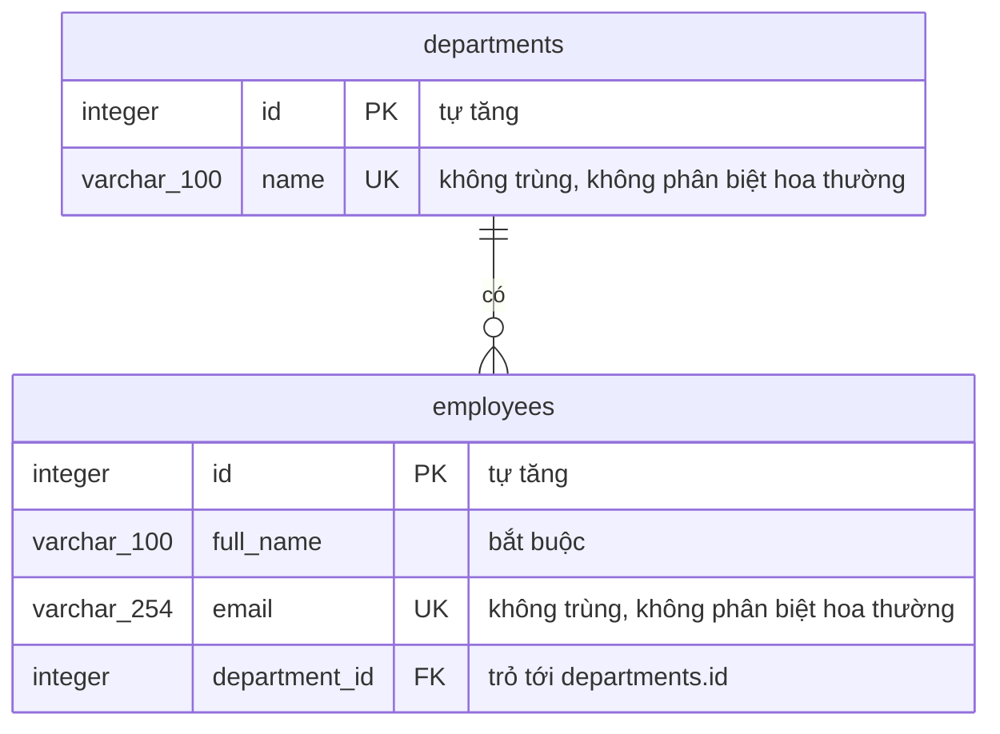

# Sơ đồ database `employee_db`

Database có hai bảng: `departments` (phòng ban) và `employees` (nhân viên). Mỗi nhân viên thuộc đúng một phòng ban. Hai bảng do hai migration EF Core tạo ra trong `backend/EmployeeCrud.Api/Migrations/`:

| Thứ tự | Migration | Tạo gì |
|---|---|---|
| 1 | `20261101183552_CreateDepartments` | Bảng `departments`, chỉ mục không trùng tên, 4 phòng ban mẫu |
| 2 | `20261102083152_CreateEmployees` | Bảng `employees`, khóa ngoại tới `departments`, chỉ mục không trùng email |

Tên bảng và tên cột viết thường, nối bằng dấu gạch dưới (kiểu `snake_case`), đúng như khi mở trong pgAdmin.

## Sơ đồ



<!-- Text fallback: Bảng departments có cột id (khóa chính, tự tăng) và name (không trùng, không phân biệt hoa thường). Bảng employees có id (khóa chính, tự tăng), full_name, email (không trùng, không phân biệt hoa thường) và department_id (khóa ngoại trỏ tới departments.id). Một phòng ban có không hoặc nhiều nhân viên; mỗi nhân viên thuộc đúng một phòng ban. -->

Đọc sơ đồ bằng lời: **một phòng ban có không hoặc nhiều nhân viên; một nhân viên thuộc đúng một phòng ban**. Kiểu `varchar_100` trong sơ đồ là `character varying(100)` trong PostgreSQL (mermaid không cho viết dấu ngoặc trong tên kiểu).

## Các cột

### Bảng `departments`

| Cột | Kiểu PostgreSQL | Cho phép rỗng | Ràng buộc | Ý nghĩa |
|---|---|---|---|---|
| `id` | `integer` | Không | Khóa chính `PK_departments`, tự tăng (identity) | Mã phòng ban |
| `name` | `character varying(100)` | Không | Không trùng (chỉ mục `ux_departments_name` trên `lower(name)`) | Tên phòng ban, tối đa 100 ký tự |

### Bảng `employees`

| Cột | Kiểu PostgreSQL | Cho phép rỗng | Ràng buộc | Ý nghĩa |
|---|---|---|---|---|
| `id` | `integer` | Không | Khóa chính `PK_employees`, tự tăng (identity) | Mã nhân viên |
| `full_name` | `character varying(100)` | Không | | Họ tên, tối đa 100 ký tự |
| `email` | `character varying(254)` | Không | Không trùng (chỉ mục `ux_employees_email` trên `lower(email)`) | Email, tối đa 254 ký tự. Được chuẩn hóa trước khi lưu (bỏ khoảng trắng hai đầu, gộp khoảng trắng, NFC), nhưng giữ nguyên chữ hoa thường như người dùng gõ |
| `department_id` | `integer` | Không | Khóa ngoại `fk_employees_department` → `departments.id`; có chỉ mục `ix_employees_department_id` | Phòng ban của nhân viên |

## Ràng buộc database tự chặn

Ứng dụng đã kiểm dữ liệu ở form React và ở API. Database chặn thêm một lớp nữa, nhưng chỉ cho các luật ở bảng dưới, cộng với `NOT NULL` và độ dài cột. Các luật còn lại (chuỗi rỗng, định dạng email, ký tự không hợp lệ) chỉ nằm ở form và API: ai chèn dữ liệu bằng câu lệnh tay thì database không chặn, nên phải tự giữ dữ liệu sạch.

| Tên | Loại | Chặn điều gì |
|---|---|---|
| `PK_departments`, `PK_employees` | Khóa chính | Hai dòng trùng `id` |
| `ux_departments_name` | Chỉ mục không trùng trên `lower(name)` | Hai phòng ban cùng tên, kể cả khác hoa thường (`Kỹ thuật` và `KỸ THUẬT` bị coi là trùng) |
| `ux_employees_email` | Chỉ mục không trùng trên `lower(email)` | Hai nhân viên cùng email, kể cả khác hoa thường |
| `fk_employees_department` | Khóa ngoại, `ON DELETE RESTRICT` | Nhân viên trỏ tới phòng ban không tồn tại; xóa phòng ban còn nhân viên |

Vì sao chỉ mục viết trên `lower(...)`: PostgreSQL so chữ có phân biệt hoa thường. Chỉ mục trên chữ đã đổi sang chữ thường thì `An@Congty.vn` và `an@congty.vn` thành một giá trị, nên bị chặn trùng. Hai chỉ mục này viết tay trong migration (lệnh `CREATE UNIQUE INDEX`) vì EF Core không tự sinh được chỉ mục trên biểu thức.

## Dữ liệu mẫu

Migration `CreateDepartments` chèn sẵn 4 phòng ban. `id` do database tự cấp, nên trên máy mới sẽ là 1–4.

| `name` |
|---|
| Nhân sự |
| Kế toán |
| Kỹ thuật |
| Kinh doanh |

Bảng `employees` lúc đầu trống. Muốn có dữ liệu để demo, chạy [`du-lieu-mau.sql`](du-lieu-mau.sql) (README mục 12): thêm 4 phòng ban và 80 nhân viên tên giả.

## Đối chiếu bằng pgAdmin

1. Mở pgAdmin 4, kết nối server PostgreSQL 18 trên máy (cổng 5432), nhập mật khẩu đã đặt lúc cài PostgreSQL.
2. Mở `Databases` → `employee_db` → `Schemas` → `public` → `Tables`: phải thấy `departments`, `employees` (và bảng `__EFMigrationsHistory` do EF Core dùng để nhớ migration nào đã chạy).
3. Mở từng bảng → `Columns`: tên cột, kiểu, "Not NULL" khớp bảng ở mục "Các cột".
4. Mở `Constraints`: thấy khóa chính; với `employees` thấy thêm khóa ngoại `fk_employees_department`.
5. Mở `Indexes`: thấy `ux_departments_name`, `ux_employees_email`, `ix_employees_department_id`.
6. Hoặc chuột phải vào `employee_db` → `ERD For Database` để pgAdmin vẽ sơ đồ, rồi so với sơ đồ ở trên.

## Thử ràng buộc bằng câu lệnh tay

Mở `employee_db` → `Query Tool` trong pgAdmin, chạy **từng khối một**. Cần có sẵn ít nhất một nhân viên (nếu chưa có, thêm một nhân viên qua giao diện trước). Hai lệnh thử đều **bị PostgreSQL từ chối**, nên dữ liệu không đổi.

**Bước 0. Đếm số dòng trước khi thử:**

```sql
SELECT (SELECT count(*) FROM departments) AS so_phong_ban,
       (SELECT count(*) FROM employees)   AS so_nhan_vien;
```

**Ca 1. Chèn email trùng, khác hoa thường.** Lấy email của nhân viên có sẵn, viết hoa toàn bộ rồi chèn:

```sql
INSERT INTO employees (full_name, email, department_id)
SELECT 'Thử Trùng Email', upper(email), department_id
FROM employees ORDER BY id LIMIT 1;
```

Kết quả mong đợi: lỗi `duplicate key value violates unique constraint "ux_employees_email"`, mã lỗi (SQLSTATE) `23505`.

Nếu lệnh **bất ngờ chạy được** thì chỉ mục không đúng như sơ đồ. Khi đó xóa đúng dòng vừa chèn, rồi báo lỗi lệch:

```sql
DELETE FROM employees WHERE full_name = 'Thử Trùng Email';
```

**Ca 2. Xóa phòng ban đang có nhân viên:**

```sql
DELETE FROM departments
WHERE id = (SELECT department_id FROM employees ORDER BY id LIMIT 1);
```

Kết quả mong đợi: lỗi `update or delete on table "departments" violates RESTRICT setting of foreign key constraint "fk_employees_department" on table "employees"`, mã lỗi (SQLSTATE) `23001`.

Vì sao là `23001` chứ không phải `23503`: khóa ngoại khai kiểu `ON DELETE RESTRICT` (chặn ngay lập tức), nên PostgreSQL báo mã riêng `23001` (restrict_violation) thay cho mã chung `23503` (foreign_key_violation) của khóa ngoại thường. Mã này đã được kiểm bằng cách chạy thật trên PostgreSQL 18.

**Bước cuối. Đếm lại:** chạy lại câu lệnh ở Bước 0, hai con số phải bằng lúc trước.

Lưu ý: một lệnh chèn bị từ chối vẫn có thể làm bộ đếm `id` tự tăng nhảy lên một số. Đó là cách PostgreSQL vận hành, không làm sai dữ liệu; nhân viên thêm sau sẽ có `id` lớn hơn một chút.
